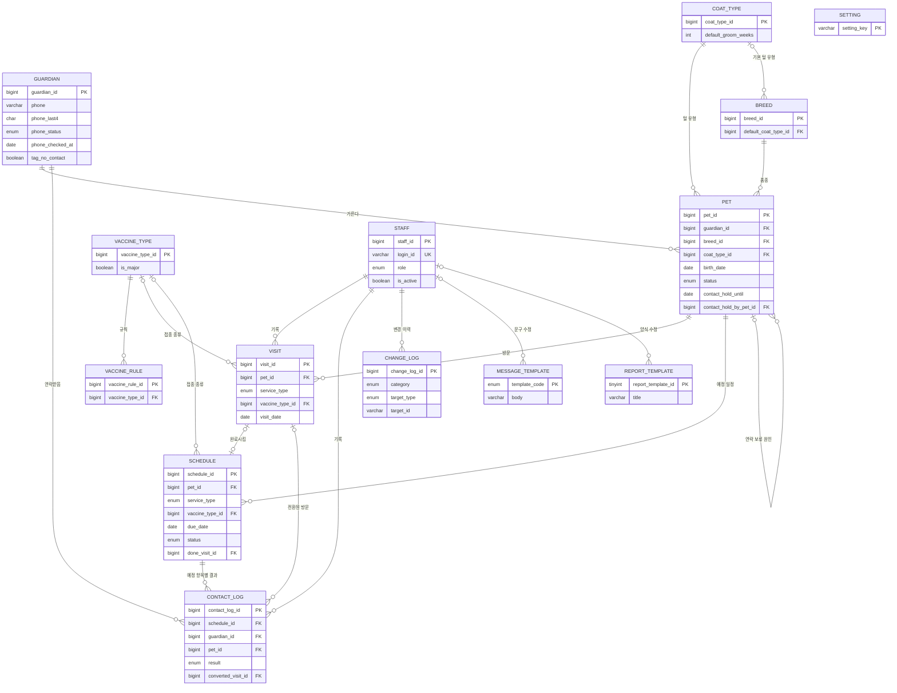

# DB 설계

| 항목 | 내용 |
| --- | --- |
| 작성 | DBA (초안) |
| 작성일 | 2026-11-23 |
| 근거 자료 | 요구사항 명세서 v3 + 백오피스 탭 추가 (기능 58개, FR-ADM-008·009), 정책 정의서 v3 + C1 변경 (POL-CNT-005, POL-RPT-001, 4-3), 이벤트 스토밍 3장 애그리거트·4장 바운디드 컨텍스트 |
| DBMS | MySQL 8.0 (InnoDB, utf8mb4 / utf8mb4_0900_ai_ci) [A2] |
| 수정 | 2026-11-23 v2: 백오피스 '문자 문구'·'리포트 양식' 탭 반영. `message_template`·`report_template` 테이블 추가, 병원 이름·전화번호를 관리자가 수정, `contact_log.sms_body`(보낸 문구 원문) 추가 2026-11-24: `rule_change_log.old_value`·`new_value`를 200자 → 1000자로 늘림 (긴 문자 문구를 고칠 때 이력 저장 실패 방지) 2026-11-24 v3: 테이블 합치기 17개 → 14개. 이력 3개(`record_edit_log`, `rule_change_log`, `pet_status_history`)를 `change_log` 하나로, `guardian_tag`를 `guardian`의 태그 칸으로 2026-11-24: 털 유형을 단모/중모/장모/곱슬 4가지로 나눔 (장모·곱슬 → 장모 5주, 곱슬 5주) |
| 상태 | 초안 v3. 접종 규칙 표 구조는 도메인 전문가 표(11/27)를 받고 확정 |

이벤트 스토밍의 애그리거트(보호자, 반려동물, 방문 기록, 예정 일정, 연락 기록, 주기 규칙, 직원)를 테이블로 옮겼다. 요구사항 명세서의 기능과 정책 정의서의 규칙이 어느 컬럼으로 지켜지는지 '근거' 칸에 적었다.

---

## 1. 설계 원칙

| 항목 | 규칙 |
| --- | --- |
| 이름 | 테이블·컬럼은 영어 snake_case, 단수형 (`guardian`, `pet`). PK는 `테이블명_id` |
| PK | `BIGINT AUTO_INCREMENT`. 화면 URL에 그대로 쓴다 (사내 직원용이라 노출 문제 없음) |
| 시간 | `DATETIME`, 한국 시간(Asia/Seoul)으로 저장. '오늘'·'이번 주(월~일)' 판단도 한국 시간 기준 [Q3] |
| 날짜 | 예정일·방문일·생년월일처럼 시각이 필요 없는 값은 `DATE` |
| 고정값 | 결과 유형·역할·연락 방법처럼 정책상 바꾸지 않는 값은 `ENUM`. 주의 태그 4가지는 보호자 테이블의 0/1 칸 [POL-DATA-009] |
| 설정값 | 품종·털 유형·접종 종류·규칙·기준값처럼 관리자가 바꾸는 값은 별도 테이블 [POL-REG-002, 정책 6장] |
| 공통 컬럼 | 직원이 남기는 데이터에는 `created_by`, `created_at`, `updated_by`, `updated_at`을 둔다 [NFR-DATA-002] |
| 전화번호 | 하이픈·띄어쓰기를 지운 숫자만 저장 (`01012345678`). 검색도 숫자만 비교한다 [FR-SRCH-001] |
| FK | 모두 `ON DELETE RESTRICT`. 실제 삭제를 하지 않으므로 연쇄 삭제를 두지 않는다 (7장) |
| 병원 | MVP는 병원 1곳이라 `hospital_id`를 두지 않는다. 병원 이름·전화번호는 `setting`에 둔다 |

---

## 2. ERD

**관계 요약**

| 관계 | 종류 | 설명 |
| --- | --- | --- |
| 보호자 → 반려동물 | 1:N | 다두 가구 [FR-CUS-003]. 아이는 보호자 1명에만 속한다 |
| 반려동물 → 방문 기록 | 1:N | 접종 1종류 또는 미용 1번이 한 행 |
| 반려동물 → 예정 일정 | 1:N | 접종 종류마다, 미용 하나씩 따로 [Q1] |
| 예정 일정 → 연락 기록 | 1:N | 연락 결과는 예정 항목(아이 × 서비스)마다 하나 [POL-CNT-002] |
| 예정 일정 ↔ 방문 기록 | 1:1 (선택) | 방문이 예정을 완료시킴 (`schedule.done_visit_id`) |
| 방문 기록 → 연락 기록 | 1:N (선택) | 전환된 연락이 가리키는 방문 (`contact_log.converted_visit_id`) |
| 반려동물 → 반려동물 | 1:N (선택) | 무지개다리 아이 때문에 같은 집 아이가 연락 보류됨 (`pet.contact_hold_by_pet_id`) |
| 접종 종류 → 접종 규칙 | 1:N | 나이 구간별 간격 |

N:M 관계는 없다. 주의 태그는 4가지로 고정이라 별도 테이블 없이 `guardian`의 칸으로 둔다. 변경 이력(`change_log`)은 여러 테이블의 변경을 한곳에 모으므로 대상 행에 FK를 걸지 않는다 (`target_type` + `target_id`로 찾음).

---

## 3. 테이블 목록

| 영역 (바운디드 컨텍스트) | 테이블 | 한글 이름 | 근거 요구사항 |
| --- | --- | --- | --- |
| 운영 | `staff` | 직원 | FR-AUTH-001~003, FR-ADM-001, FR-ADM-007 |
| 운영 | `setting` | 기준값·병원 정보 | FR-ADM-004, FR-ADM-008, FR-DATA-002·003 |
| 운영 | `message_template` | 문자 안내 문구 | FR-ADM-008, FR-CNT-007 |
| 운영 | `report_template` | 리포트 양식 | FR-ADM-009, FR-RPT-001 |
| 운영 | `change_log` | 변경 이력 (기록 수정·규칙 변경·아이 상태·주의 태그) | FR-ADM-006, FR-COM-004, FR-CUS-007·008 |
| 고객 관리 | `guardian` | 보호자 (주의 태그 포함) | FR-CUS-001·002·004·005·006·008 |
| 고객 관리 | `pet` | 반려동물 | FR-CUS-001·003·004·007·008 |
| 고객 관리 | `breed` | 품종 선택지 | FR-ADM-005 |
| 주기 계산 | `coat_type` | 털 유형·미용 기본 간격 | FR-CYC-002, FR-ADM-003·005 |
| 주기 계산 | `vaccine_type` | 접종 종류 | FR-CYC-001, FR-DASH-002 |
| 주기 계산 | `vaccine_rule` | 접종 규칙 | FR-CYC-001, FR-ADM-002 |
| 주기 계산 | `schedule` | 예정 일정 | FR-CYC-001~004, FR-TGT-001~004 |
| 방문 기록 | `visit` | 방문 기록 | FR-VIS-001~004 |
| 연락 관리 | `contact_log` | 연락 기록 | FR-CNT-001~007 |

총 14개. 대시보드·리포트(분석·리포트 컨텍스트)는 위 테이블을 읽기만 하므로 테이블을 따로 두지 않는다.

---

## 4. 테이블 정의서

표기: PK 기본키, FK 외래키, UK 유니크, IDX 인덱스, NN NOT NULL. 공통 컬럼(`created_by`, `created_at`, `updated_by`, `updated_at`)은 표마다 '공통'으로 줄였다.

| 공통 컬럼 | 타입 | NULL | 기본값 | 설명 |
| --- | --- | --- | --- | --- |
| created_by | BIGINT | NN | - | FK → staff. 만든 직원 |
| created_at | DATETIME | NN | CURRENT_TIMESTAMP | 만든 시간 |
| updated_by | BIGINT | NULL | - | FK → staff. 마지막으로 고친 직원 |
| updated_at | DATETIME | NN | CURRENT_TIMESTAMP ON UPDATE | 마지막으로 고친 시간 |

### 4-1. staff (직원)

| 컬럼 | 타입 | NULL | 제약 | 기본값 | 설명 | 근거 |
| --- | --- | --- | --- | --- | --- | --- |
| staff_id | BIGINT | NN | PK, AI | - | 직원 ID | |
| login_id | VARCHAR(30) | NN | UK | - | 로그인 아이디 | FR-AUTH-001 |
| password_hash | VARCHAR(100) | NN | - | - | BCrypt 해시. 평문 저장 금지 | NFR-SEC-001 |
| name | VARCHAR(30) | NN | - | - | 이름 (기록에 '기록한 직원'으로 보임) | NFR-DATA-002 |
| role | ENUM('ADMIN','DESK','GROOMER') | NN | - | - | 관리자(원장·데스크 실장) / 데스크 / 미용사 | POL-ACC-001 |
| is_active | TINYINT(1) | NN | - | 1 | 0이면 비활성(퇴사). 로그인 불가 | POL-ACC-004 |
| deactivated_at | DATETIME | NULL | - | - | 비활성화한 시간 | |
| must_change_password | TINYINT(1) | NN | - | 0 | 임시 비밀번호로 초기화하면 1. 로그인 뒤 새 비밀번호를 정해야 0 | POL-ACC-010 |
| last_login_at | DATETIME | NULL | - | - | 마지막 로그인 | |
| created_at, updated_at | | | | | 공통 (첫 계정은 시드라 created_by 없음) | |

로그인 유지(8시간)는 세션·토큰 만료로 처리하고 테이블에 두지 않는다 [POL-ACC-005].

### 4-2. guardian (보호자)

| 컬럼 | 타입 | NULL | 제약 | 기본값 | 설명 | 근거 |
| --- | --- | --- | --- | --- | --- | --- |
| guardian_id | BIGINT | NN | PK, AI | - | 보호자 ID | |
| name | VARCHAR(30) | NN | IDX | - | 보호자 이름 | |
| name_chosung | VARCHAR(30) | NN | IDX | - | 이름 초성 ('ㄱㅁㅅ'). 저장할 때 서버가 채움 | FR-SRCH-003 |
| phone | VARCHAR(11) | NN | IDX | - | 숫자만. **UK 아님**: 같은 번호여도 새로 만들 수 있다 | POL-REG-005 |
| phone_last4 | CHAR(4) | NN | IDX | 생성 컬럼 `RIGHT(phone,4)` STORED | 번호 뒤 4자리 검색·목록 표시 | FR-SRCH-001, POL-DATA-002 |
| sub_phone | VARCHAR(11) | NULL | - | - | 보조 연락처(가족) 1개 | FR-CUS-004 |
| preferred_contact | ENUM('PHONE','SMS') | NULL | - | - | 선호 연락 방법 | FR-CUS-004 |
| phone_status | ENUM('OK','WRONG') | NN | IDX | 'OK' | '번호 오류' 결과면 WRONG, 번호를 고치거나 [확인함]이면 OK | FR-CNT-003, FR-DASH-004 |
| phone_checked_at | DATE | NN | - | 등록일 | 번호를 마지막으로 확인한 날. 1년 지나면 확인 배너. 번호를 고치면 오늘로 | POL-REG-008 |
| privacy_agreed | TINYINT(1) | NN | - | 0 | 개인정보 수집·이용 동의 | POL-REG-010 |
| privacy_agreed_at | DATETIME | NULL | - | - | 동의한 시간 | |
| sms_agreed | TINYINT(1) | NN | - | 0 | 안내 문자 수신 동의. 0이면 문자 버튼 끔 | POL-REG-010, FR-CNT-005 |
| sms_agreed_at | DATETIME | NULL | - | - | 동의한 시간 | |
| tag_no_contact | TINYINT(1) | NN | - | 0 | 주의 태그 '연락 원치 않음'. 1이면 연락 대상에서 뺌 | POL-TGT-004, FR-CUS-005 |
| tag_sms_only | TINYINT(1) | NN | - | 0 | 주의 태그 '문자만' | FR-CUS-005 |
| tag_sensitive | TINYINT(1) | NN | - | 0 | 주의 태그 '예민함' | FR-CUS-005 |
| tag_contact_time | TINYINT(1) | NN | - | 0 | 주의 태그 '연락 선호 시간' | FR-CUS-005 |
| contact_time_note | VARCHAR(50) | NULL | CHECK: 태그가 켜져 있을 때만 | - | 연락 선호 시간 내용 (예: '오후 2시 이후') | |
| 공통 | | | | | | |

주의 태그는 4가지로 고정이라 [POL-DATA-009, NFR-DATA-003] 별도 테이블 없이 칸 4개로 둔다. 태그를 붙이거나 떼면 `change_log`에 `TAG_CHANGE`로 남긴다.

### 4-3. pet (반려동물)

| 컬럼 | 타입 | NULL | 제약 | 기본값 | 설명 | 근거 |
| --- | --- | --- | --- | --- | --- | --- |
| pet_id | BIGINT | NN | PK, AI | - | 반려동물 ID | |
| guardian_id | BIGINT | NN | FK → guardian, IDX | - | 보호자 | FR-CUS-003 |
| name | VARCHAR(30) | NN | IDX | - | 아이 이름 | |
| name_chosung | VARCHAR(30) | NN | IDX | - | 이름 초성 | FR-SRCH-003 |
| species | ENUM('DOG') | NN | - | 'DOG' | 동물 종류. MVP는 강아지만, 확장 때 값 추가 | POL-REG-003, NFR-EXT-002 |
| breed_id | BIGINT | NN | FK → breed | - | 품종 | POL-REG-001 |
| coat_type_id | BIGINT | NN | FK → coat_type | - | 털 유형 | POL-REG-001 |
| birth_date | DATE | NN | - | - | 생년월일 (추정이면 오늘 − 대략 나이) | POL-REG-004 |
| birth_date_estimated | TINYINT(1) | NN | - | 0 | 1이면 '추정' 표시 | POL-REG-004 |
| registration_no | VARCHAR(20) | NULL | - | - | 병원 등록번호 | FR-CUS-004 |
| photo_url | VARCHAR(255) | NULL | - | - | 사진 경로 (거절하면 NULL) | POL-REG-007 |
| has_pet_insurance | TINYINT(1) | NULL | - | - | 펫보험 가입 여부 (NULL = 모름) | FR-CUS-004 |
| weight_kg | DECIMAL(4,1) | NULL | - | - | 현재 체중 | FR-CUS-004 |
| status | ENUM('ACTIVE','RAINBOW') | NN | IDX | 'ACTIVE' | RAINBOW면 대상·누락·통계에서 제외, 검색엔 회색 | POL-END-001·002 |
| rainbow_at | DATETIME | NULL | - | - | 무지개다리로 바꾼 시간 | |
| contact_hold_until | DATE | NULL | IDX | - | 이 날까지 연락 보류 (같은 집 아이가 무지개다리) | POL-TGT-003 |
| contact_hold_by_pet_id | BIGINT | NULL | FK → pet | - | 보류 원인이 된 아이. 되돌리기 때 이 값으로 보류를 푼다 | POL-END-004 |
| groom_interval_days | SMALLINT | NULL | - | - | 마지막으로 계산한 개인 미용 주기 (화면 표시용 캐시) | FR-CYC-002 |
| groom_interval_basis | ENUM('DEFAULT','MEDIAN') | NULL | - | - | 기본 간격으로 계산했는지, 중앙값인지 | POL-CYC-002·003 |
| 공통 | | | | | | |

상태를 바꾸면(무지개다리, 되돌리기) `change_log`에 `STATUS_CHANGE`로 남긴다. 되돌린 뒤 빠졌던 기간을 소급 계산할 때 이 이력으로 기간을 찾는다 [POL-END-004, S11].

### 4-4. breed (품종 선택지)

| 컬럼 | 타입 | NULL | 제약 | 기본값 | 설명 | 근거 |
| --- | --- | --- | --- | --- | --- | --- |
| breed_id | BIGINT | NN | PK, AI | - | | |
| species | ENUM('DOG') | NN | UK(species, name) | 'DOG' | | |
| name | VARCHAR(50) | NN | UK(species, name) | - | 품종 이름 (말티즈, 푸들 …) | POL-REG-002 |
| default_coat_type_id | BIGINT | NULL | FK → coat_type | - | 등록 화면에서 품종을 고르면 미리 골라 둘 털 유형 | |
| sort_order | INT | NN | - | 0 | 선택지 순서 | |
| is_active | TINYINT(1) | NN | - | 1 | 0이면 선택지에서 숨김 (이미 쓴 아이는 그대로) | |
| 공통 | | | | | | |

### 4-5. coat_type (털 유형·미용 기본 간격)

| 컬럼 | 타입 | NULL | 제약 | 기본값 | 설명 | 근거 |
| --- | --- | --- | --- | --- | --- | --- |
| coat_type_id | BIGINT | NN | PK, AI | - | | |
| code | VARCHAR(20) | NN | UK | - | 'SHORT', 'MEDIUM', 'LONG', 'CURLY' | POL-DATA-009 |
| name | VARCHAR(20) | NN | - | - | 단모 / 중모 / 장모 / 곱슬 | |
| default_groom_weeks | TINYINT | NN | CHECK > 0 | - | 미용 기본 간격(주). 기본 10 / 7 / 5 / 5 | POL-CYC-002, POL-ERR-006 |
| sort_order | INT | NN | - | 0 | | |
| is_active | TINYINT(1) | NN | - | 1 | | |
| 공통 | | | | | | |

### 4-6. vaccine_type (접종 종류)

| 컬럼 | 타입 | NULL | 제약 | 기본값 | 설명 | 근거 |
| --- | --- | --- | --- | --- | --- | --- |
| vaccine_type_id | BIGINT | NN | PK, AI | - | | |
| code | VARCHAR(30) | NN | UK | - | 'DHPPL', 'CORONA', 'KENNEL', 'RABIES', 'INFLUENZA', 'HEARTWORM', 'DEWORM' 등 | |
| name | VARCHAR(50) | NN | - | - | 종합백신, 광견병, 심장사상충 예방약 … | |
| is_major | TINYINT(1) | NN | - | 0 | 1 = 주요 접종. 접종 누락률에는 1인 종류만 넣는다 (심장사상충·구충은 0) | POL-MISS-004, FR-DATA-003 |
| sort_order | INT | NN | - | 0 | | |
| is_active | TINYINT(1) | NN | - | 1 | | |
| 공통 | | | | | | |

### 4-7. vaccine_rule (접종 규칙)

나이 구간마다 '이 구간에서는 며칠 간격으로 맞는다'를 한 행으로 둔다. **도메인 전문가의 접종 규칙 표(11/27, 더미 데이터 매뉴얼 1-1 양식)를 받으면 컬럼을 다시 맞춘다.**

| 컬럼 | 타입 | NULL | 제약 | 기본값 | 설명 | 근거 |
| --- | --- | --- | --- | --- | --- | --- |
| vaccine_rule_id | BIGINT | NN | PK, AI | - | | |
| vaccine_type_id | BIGINT | NN | FK → vaccine_type, IDX | - | | |
| phase | ENUM('PRIMARY','BOOSTER','PREVENTIVE') | NN | - | - | 기초접종 / 추가접종 / 예방약 | FR-CYC-001 |
| age_from_days | INT | NN | CHECK >= 0 | - | 이 구간 시작 나이(일). 기록이 없으면 이 나이가 첫 예정일 | |
| age_to_days | INT | NULL | - | - | 이 구간 끝 나이(일, 미만). NULL이면 끝 없음 | |
| interval_days | INT | NN | CHECK > 0 | - | 마지막 접종일 + 이 값 = 다음 예정일 | POL-CYC-001 |
| dose_count | TINYINT | NULL | - | - | 이 구간에서 맞는 횟수 (기초접종 5회 등). NULL이면 계속 반복 | |
| note | VARCHAR(200) | NULL | - | - | 근거 자료 메모 | V10 |
| is_active | TINYINT(1) | NN | - | 1 | | |
| 공통 | | | | | | |

### 4-8. setting (기준값)

| 컬럼 | 타입 | NULL | 제약 | 기본값 | 설명 | 근거 |
| --- | --- | --- | --- | --- | --- | --- |
| setting_key | VARCHAR(50) | NN | PK | - | 키 (아래 표) | |
| setting_value | VARCHAR(100) | NN | - | - | 값 (문자로 저장, 서버가 value_type대로 변환) | |
| value_type | ENUM('INT','DATE','STRING') | NN | - | - | | |
| description | VARCHAR(200) | NULL | - | - | 화면에 보일 설명 | |
| updated_by, updated_at | | | | | 공통 | |

| setting_key | 기본값 | 백오피스에서 수정 | 근거 |
| --- | --- | --- | --- |
| MISS_THRESHOLD_DAYS | 14 | O (비었거나 0이면 저장 막음) | POL-MISS-001, POL-ERR-006 |
| RAINBOW_HOLD_DAYS | 30 | O | POL-TGT-003 |
| HOSPITAL_NAME | (시연 병원 이름) | O ('문자 문구' 탭). 문자와 리포트에 같이 씀 | FR-ADM-008, POL-RPT-001 |
| HOSPITAL_PHONE | (시연 병원 번호) | O ('문자 문구' 탭). 숫자만 저장 | FR-ADM-008, 정책 4-3 |
| CRM_START_DATE | (더미 데이터에서 정함) | X (시드) | FR-DATA-002 |

### 4-9. visit (방문 기록)

접종 1종류 또는 미용 1번이 한 행이다. 같은 날 종합백신과 광견병을 맞으면 2행.

| 컬럼 | 타입 | NULL | 제약 | 기본값 | 설명 | 근거 |
| --- | --- | --- | --- | --- | --- | --- |
| visit_id | BIGINT | NN | PK, AI | - | | |
| pet_id | BIGINT | NN | FK → pet | - | | |
| service_type | ENUM('VACCINE','GROOMING') | NN | - | - | 접종 / 미용 | |
| vaccine_type_id | BIGINT | NULL | FK → vaccine_type | - | 접종이면 필수, 미용이면 NULL (CHECK) | FR-VIS-001 |
| visit_date | DATE | NN | - | 오늘 | 방문일 | FR-VIS-002 |
| memo | VARCHAR(200) | NULL | - | - | 메모 200자 | POL-DATA-010 |
| brought_by_phone | VARCHAR(11) | NULL | - | - | 주 보호자와 다른 가족이 데려왔을 때 그 번호. 보호자 정보는 안 바꿈 | POL-REG-006 |
| is_edited | TINYINT(1) | NN | - | 0 | 1이면 '수정됨' 표시 | POL-DATA-007 |
| 공통 | | | | | | |

- CHECK: `(service_type='VACCINE' AND vaccine_type_id IS NOT NULL) OR (service_type='GROOMING' AND vaccine_type_id IS NULL)`
- IDX: `(pet_id, service_type, visit_date)` 타임라인·미용 간격 계산

### 4-10. schedule (예정 일정)

아이 × 서비스(접종은 종류마다) 한 주기가 한 행이다. 방문으로 완료되면 다음 주기 행을 새로 만든다. 지난 주기 행은 고치지 않아 통계가 흔들리지 않는다 [POL-CYC-005].

| 컬럼 | 타입 | NULL | 제약 | 기본값 | 설명 | 근거 |
| --- | --- | --- | --- | --- | --- | --- |
| schedule_id | BIGINT | NN | PK, AI | - | | |
| pet_id | BIGINT | NN | FK → pet | - | | |
| service_type | ENUM('VACCINE','GROOMING') | NN | - | - | | |
| vaccine_type_id | BIGINT | NULL | FK → vaccine_type | - | 접종이면 필수 (CHECK는 visit과 같음) | Q1 |
| due_date | DATE | NN | IDX | - | 개인 예정일 | FR-CYC-001·002 |
| status | ENUM('OPEN','DONE','VOID') | NN | IDX | 'OPEN' | 진행 중 / 방문으로 완료 / 다시 계산으로 무효 | |
| miss_threshold_days | SMALLINT | NN | - | 만들 때 설정값 복사 | 이 주기의 누락 기준. 설정을 바꿔도 지난 판정은 그대로 | POL-CYC-005 |
| missed_at | DATE | NULL | IDX | - | 누락으로 판정된 날 (due_date + 기준 + 1). 방문해도 지우지 않음 (누락 이력) | POL-MISS-001 |
| done_visit_id | BIGINT | NULL | FK → visit, UK | - | 이 주기를 완료시킨 방문 | POL-MISS-002 |
| done_date | DATE | NULL | - | - | 완료 방문일 | |
| gap_days | INT | NULL | - | - | done_date − due_date (예정일 대비 실제 방문 차이) | FR-DASH-002 |
| contact_state | ENUM('NONE','NO_ANSWER','BOOKED','REFUSED','OTHER_HOSPITAL','WRONG_NUMBER','CLOSED') | NN | IDX | 'NONE' | 이 주기의 마지막 연락 결과. 대상 목록 제외 판단에 쓴다 (CLOSED = 전화 안 받음 2일차 뒤 문자 보내고 주기 끝) | POL-TGT-005~009 |
| no_answer_count | TINYINT | NN | - | 0 | '전화 안 받음' 연속 횟수 (2가 되면 문자 안내 후 CLOSED) | POL-TGT-006 |
| next_contact_date | DATE | NULL | IDX | - | 다음 연락 예정일. 이 날 전에는 대상에서 뺌 | POL-TGT-005 |
| active_key | VARCHAR(50) | NULL | UK | 생성 컬럼 | `IF(status='OPEN', CONCAT(pet_id,'-',service_type,'-',IFNULL(vaccine_type_id,0)), NULL)`. 같은 아이·서비스에 진행 중인 주기가 2개 생기지 않게 막음 | |
| created_at, updated_at | | | | | 공통 (시스템이 만들어 created_by 없음) | |

`contact_state`, `no_answer_count`, `next_contact_date`는 `contact_log`에서 계산할 수 있는 값을 목록 속도 때문에 미리 저장한 것이다. 연락 기록을 저장할 때 같은 트랜잭션에서 함께 고친다.

### 4-11. contact_log (연락 기록)

한 번 저장할 때 예정 항목마다 한 행씩 만든다 [POL-CNT-002]. 같은 저장에서 나온 행은 `contact_group_id`가 같다.

| 컬럼 | 타입 | NULL | 제약 | 기본값 | 설명 | 근거 |
| --- | --- | --- | --- | --- | --- | --- |
| contact_log_id | BIGINT | NN | PK, AI | - | | |
| contact_group_id | CHAR(36) | NN | IDX | - | 한 번에 저장한 묶음 (UUID) | |
| guardian_id | BIGINT | NN | FK → guardian | - | 연락한 보호자 | |
| pet_id | BIGINT | NN | FK → pet | - | 대상 아이 ('처리한 아이 수' 집계) | POL-MISS-009 |
| schedule_id | BIGINT | NN | FK → schedule | - | 대상 예정 항목 | POL-CNT-002 |
| method | ENUM('PHONE','SMS') | NN | - | - | 연락 방법 | POL-CNT-003 |
| result | ENUM('BOOKED','NO_ANSWER','REFUSED','OTHER_HOSPITAL','WRONG_NUMBER') | NULL | IDX | - | 결과 유형 5가지. 문자 모의 발송만 하고 결과가 없으면 NULL (CHECK: PHONE이면 NN) | POL-CNT-002 |
| is_mock_sms | TINYINT(1) | NN | - | 0 | 문자 모의 발송 기록 | POL-CNT-005 |
| sms_template | ENUM('VACCINE','GROOMING') | NULL | - | - | 어느 문구를 썼는지 (문구 종류별 집계용) | 정책 4-3 |
| sms_body | VARCHAR(1000) | NULL | CHECK: 모의 발송이면 NN | - | 실제로 보낸 문구 원문 ({아이 이름} 등을 채운 뒤). 관리자가 문구를 고쳐도 그때 보낸 내용이 남는다 | FR-ADM-008 |
| talked_with | ENUM('SELF','FAMILY') | NULL | - | - | 통화한 사람 | POL-CNT-003 |
| memo | VARCHAR(200) | NULL | - | - | 메모 200자 (접종은 누락 종류·맞을 종류) | POL-DATA-010, POL-CNT-008 |
| next_contact_date | DATE | NULL | - | - | 입력한 다음 연락 예정일 (전화 안 받음 기본 1일 뒤) | POL-TGT-006 |
| contacted_at | DATETIME | NN | IDX | CURRENT_TIMESTAMP | 연락한 시간 | |
| is_converted | TINYINT(1) | NN | IDX | 0 | 1 = 재방문 전환 | POL-MISS-005~007 |
| converted_visit_id | BIGINT | NULL | FK → visit | - | 전환된 방문 | |
| is_edited | TINYINT(1) | NN | - | 0 | '수정됨' 표시 | POL-DATA-007 |
| 공통 | | | | | created_by = 기록한 직원 | NFR-DATA-002 |

- IDX `(guardian_id, contacted_at)`: 오늘 이미 연락함 표시 [POL-CNT-006]
- IDX `(schedule_id, contacted_at)`: 방문 직전 마지막 연락 찾기 [POL-MISS-006]
- 병원이 건 재방문 연락만 기록하므로 보호자가 걸어온 문의를 넣는 칸은 없다 [POL-CNT-001]

### 4-12. message_template (문자 안내 문구)

백오피스 '문자 문구' 탭에서 고치는 문구 2개다. 종류마다 한 행 [FR-ADM-008].

| 컬럼 | 타입 | NULL | 제약 | 기본값 | 설명 | 근거 |
| --- | --- | --- | --- | --- | --- | --- |
| template_code | ENUM('VACCINE','GROOMING') | NN | PK | - | 접종 안내 / 미용 안내 | 정책 4-3 |
| body | VARCHAR(1000) | NN | CHECK: `{아이 이름}`과 `{예정일}`이 들어 있어야 함 | - | 지금 쓰는 문구. `{병원 이름}`, `{접종 종류}` 같은 칸은 보낼 때 채운다 | POL-CNT-005 |
| default_body | VARCHAR(1000) | NN | - | 정책 4-3 문구 | [기본 문구로 되돌리기]를 누르면 body에 복사할 원래 문구. 화면에서는 고치지 않는다 | FR-ADM-008 |
| updated_by, updated_at | | | | | 공통 | |

단문(SMS)·장문(LMS) 표시는 글자 수로 화면에서 계산하고 저장하지 않는다.

### 4-13. report_template (리포트 양식)

백오피스 '리포트 양식' 탭의 값이다. 병원은 1곳이라 **행도 1개**만 둔다 (`report_template_id = 1`) [FR-ADM-009].

| 컬럼 | 타입 | NULL | 제약 | 기본값 | 설명 | 근거 |
| --- | --- | --- | --- | --- | --- | --- |
| report_template_id | TINYINT | NN | PK, CHECK = 1 | 1 | 행을 1개로 고정 | |
| title | VARCHAR(50) | NN | - | '아이 일정 요약' | 리포트 제목 | POL-RPT-001 |
| show_pet_info | TINYINT(1) | NN | - | 1 | 아이 정보 담기 | POL-RPT-001 |
| show_next_due | TINYINT(1) | NN | - | 1 | 다음 예정일 담기 | POL-RPT-001 |
| show_history | TINYINT(1) | NN | - | 1 | 지난 접종·미용 담기 | POL-RPT-001 |
| show_guidance | TINYINT(1) | NN | - | 1 | 병원에서 드린 안내(연락 기록 요약) 담기 | POL-RPT-001 |
| history_months | SMALLINT | NULL | CHECK > 0 | 12 | 지난 이력을 몇 개월 치 보여줄지. NULL = 전체 | POL-RPT-001 |
| footer_text | VARCHAR(300) | NULL | - | - | 리포트 아래 안내 문구 | POL-RPT-001 |
| updated_by, updated_at | | | | | 공통 | |

- 네 항목이 모두 꺼지면 빈 리포트가 되므로 CHECK로 하나 이상 켜져 있게 한다.
- **진료 내용 칸은 일부러 두지 않았다.** 칸이 없으니 설정으로도 리포트에 진료 내용이 들어갈 수 없다 [POL-RPT-002].
- 병원 이름·전화번호는 이 테이블에 두지 않고 `setting`의 `HOSPITAL_NAME`, `HOSPITAL_PHONE`을 문자와 함께 쓴다 [POL-RPT-001].

### 4-14. change_log (변경 이력)

예전 v2의 이력 테이블 3개(기록 수정, 규칙 변경, 아이 상태)를 하나로 합쳤다. 무엇을 바꾸든 바뀐 칸의 전·후 값을 JSON으로 한 행에 남긴다. **추가만 하고 수정·삭제하지 않는다.**

| 컬럼 | 타입 | NULL | 제약 | 기본값 | 설명 | 근거 |
| --- | --- | --- | --- | --- | --- | --- |
| change_log_id | BIGINT | NN | PK, AI | - | | |
| category | ENUM('RECORD_EDIT','RULE_CHANGE','STATUS_CHANGE','TAG_CHANGE') | NN | IDX | - | 기록 수정 / 규칙·설정 변경 / 아이 상태 변경 / 주의 태그 변경 | POL-DATA-006, FR-ADM-006, POL-END-004 |
| target_type | ENUM('VISIT','CONTACT_LOG','PET','GUARDIAN','VACCINE_TYPE','VACCINE_RULE','COAT_TYPE','BREED','SETTING','MESSAGE_TEMPLATE','REPORT_TEMPLATE') | NN | IDX | - | 바뀐 대상 테이블 | |
| target_id | VARCHAR(50) | NN | IDX | - | 바뀐 행의 ID. `setting`은 setting_key, 문자 문구는 template_code | |
| before_json | JSON | NULL | - | - | 바꾸기 전 값 (바뀐 칸만). 새로 만든 행이면 NULL | |
| after_json | JSON | NN | - | - | 바꾼 뒤 값 (바뀐 칸만) | |
| created_by, created_at | | | | | 공통. 바꾼 직원·시간 | NFR-DATA-002, POL-DATA-008 |

| 언제 | category | target_type / target_id | before_json → after_json 예 |
| --- | --- | --- | --- |
| 방문 기록 메모 수정 | RECORD_EDIT | VISIT / 15 | `{"memo": "기침"}` → `{"memo": "기침, 다음 접종 때 확인"}` |
| 누락 기준 변경 | RULE_CHANGE | SETTING / MISS_THRESHOLD_DAYS | `{"setting_value": "14"}` → `{"setting_value": "21"}` |
| 문자 문구 수정 | RULE_CHANGE | MESSAGE_TEMPLATE / VACCINE | `{"body": "…"}` → `{"body": "…"}` |
| 무지개다리 | STATUS_CHANGE | PET / 3 | `{"status": "ACTIVE"}` → `{"status": "RAINBOW"}` |
| 연락 원치 않음 태그 붙임 | TAG_CHANGE | GUARDIAN / 7 | `{"tag_no_contact": 0}` → `{"tag_no_contact": 1}` |

- 기록 수정 가능 조건(본인 기록, 남긴 날만)은 서버에서 `created_by = 로그인 직원 AND DATE(created_at) = 오늘`로 확인한다 [POL-DATA-006].
- 여러 테이블의 변경을 모으므로 `target_id`에 FK를 걸 수 없다. 서버가 대상 종류와 ID를 맞게 넣어야 한다.
- 이력 화면은 `idx_change_target`(대상별), `idx_change_category`(규칙 변경 이력 탭처럼 종류별)로 찾는다.

---

## 5. 주요 규칙이 DB에서 동작하는 방식

### 5-1. 예정 일정 흐름

| 사건 | DB 처리 | 근거 |
| --- | --- | --- |
| 아이 등록 | 접종 종류마다 `vaccine_rule`로 첫 예정일 계산, 미용은 털 유형 기본 간격으로 `schedule` OPEN 행 생성 | FR-CUS-001 |
| 방문 기록 | `visit` 저장 → 같은 아이·서비스(·종류)의 OPEN `schedule`을 DONE으로 (`done_visit_id`, `done_date`, `gap_days`) → 다음 주기 OPEN 행 생성 → 전환 판정 | FR-CYC-003 |
| 미용 주기 | 그 아이 `visit`(GROOMING) 최근 5건으로 간격 4개 → 기본 간격 2배 초과 간격 제외 → 2개 이상이면 중앙값, 아니면 기본 간격 → `pet.groom_interval_days` | POL-CYC-002·003 |
| 규칙·프로필 변경 | `due_date >= 오늘`인 OPEN 행만 다시 계산해 `due_date` 수정. 적용 대상이 아니게 된 종류는 VOID. 지난 행은 그대로 | POL-CYC-005 |
| 누락 판정 | 매일 0시 배치: OPEN이고 `due_date + miss_threshold_days < 오늘`인데 `missed_at`이 NULL이면 `missed_at = 오늘` | POL-MISS-001 |

### 5-2. 연락 대상 목록 조건

오늘 탭은 아래를 모두 만족하는 `schedule` OPEN 행을 보호자별로 묶는다 [POL-TGT-001~011].

- `pet.status = 'ACTIVE'`, `pet.contact_hold_until`이 NULL이거나 오늘보다 이전
- 보호자의 `guardian.tag_no_contact = 0` ('연락 원치 않음' 태그 없음)
- `due_date <= 오늘` (이번 주 탭은 이번 주 일요일까지)
- `next_contact_date`가 NULL이거나 오늘 이전·당일
- `contact_state`가 'REFUSED', 'OTHER_HOSPITAL', 'CLOSED', 'BOOKED'가 아님. 'BOOKED'는 `missed_at`이 생기면 누락 탭에 다시 나온다
- 정렬: `due_date` 오래된 순 [Q2]
- 오늘 결과를 기록한 줄('처리됨')은 그날 `contact_log.contacted_at`이 오늘인 행으로 찾아 아래에 둔다 [POL-TGT-010]

### 5-3. 전환 판정

방문을 저장할 때 그 방문이 완료시킨 `schedule`의 `contact_log` 중 `contacted_at`이 가장 늦은 1건을 찾는다. `visit_date <= due_date + miss_threshold_days`이면 그 행만 `is_converted = 1`, `converted_visit_id`를 채운다 [POL-MISS-005~007]. 예정 항목 단위로 연결돼 있어 '연락한 서비스로 왔을 때만'이 자동으로 지켜진다.

### 5-4. 지표 계산

| 지표 | 계산 | 근거 |
| --- | --- | --- |
| 재방문율 | 기간 안에 `due_date`가 있는 `schedule`(VOID 제외, ACTIVE 아이) 중 `done_date <= due_date + miss_threshold_days`인 비율. 아이 기준이라 `pet_id`로 중복 제거 | POL-MISS-003 |
| 접종 누락률 | 같은 대상 중 `vaccine_type.is_major = 1`만, 재방문율의 나머지 | POL-MISS-004 |
| 예정일 대비 차이 | `gap_days` 평균 | FR-DASH-002 |
| 결과 유형별·방법별 전환율 | `contact_log`를 `result`·`method`로 묶어 `is_converted` 비율 | FR-DASH-003 |
| 처리한 아이 수 | 오늘 `contact_log`의 `DISTINCT pet_id` | POL-MISS-009 |
| 번호 오류 모음 | `guardian.phone_status = 'WRONG'` | FR-DASH-004 |

---

## 6. 인덱스

| 테이블 | 인덱스 | 쓰는 곳 |
| --- | --- | --- |
| guardian | `idx_guardian_phone (phone)` | 같은 번호 경고, 번호 검색 |
| guardian | `idx_guardian_phone_last4 (phone_last4)` | 번호 뒤 4자리 검색 |
| guardian | `idx_guardian_name (name)`, `idx_guardian_chosung (name_chosung)` | 이름·초성 검색 |
| guardian | `idx_guardian_phone_status (phone_status)` | 번호 오류 모음 |
| pet | `idx_pet_guardian (guardian_id)` | 같은 집 아이 |
| pet | `idx_pet_name (name)`, `idx_pet_chosung (name_chosung)` | 아이 이름·초성 검색 |
| schedule | `idx_schedule_target (status, due_date)` | 오늘·이번 주·누락 탭 |
| schedule | `idx_schedule_pet (pet_id, service_type, status)` | 아이 상세, 방문 때 OPEN 행 찾기 |
| schedule | `uk_schedule_active (active_key)` | 진행 중 주기 중복 방지 |
| visit | `idx_visit_pet (pet_id, service_type, visit_date)` | 타임라인, 미용 간격 |
| contact_log | `idx_contact_guardian (guardian_id, contacted_at)` | 오늘 연락함, 지난 연락 |
| contact_log | `idx_contact_schedule (schedule_id, contacted_at)` | 전환 판정 |
| contact_log | `idx_contact_stats (contacted_at, result, method)` | 전환율 지표 |
| change_log | `idx_change_target (target_type, target_id, created_at)` | 기록·아이별 변경 이력 보기 |
| change_log | `idx_change_category (category, created_at)` | 규칙 변경 이력 탭 |

이름 검색은 `LIKE '검색어%'`(앞부분 일치)로 인덱스를 탄다. 보호자 300명·반려견 400마리 규모라 0.5초 목표 [NFR-PERF-003] 안에 들어온다.

---

## 7. 데이터 이력 관리 정책 (삭제)

**원칙: 업무 기록은 실제로 지우지 않는다 (Soft Delete).** 상태값으로 표시하고, 바뀐 내용은 이력 테이블에 남긴다 [NFR-DATA-001, POL-DATA-004].

| 테이블 | 삭제 방식 | 방법 | 근거 |
| --- | --- | --- | --- |
| staff | Soft | `is_active = 0`, `deactivated_at`. 남긴 기록의 `created_by`는 그대로 | POL-ACC-004 |
| guardian | 삭제 기능 없음 | 합치기·삭제 없음. 번호 바꾸면 수정 | POL-REG-005 |
| pet | Soft | `status = 'RAINBOW'`. 되돌리기 가능, `change_log`(STATUS_CHANGE)에 남김 | POL-END-001·004 |
| visit, contact_log | 삭제 없음 | 당일 본인만 수정, 전후 값은 `change_log`(RECORD_EDIT), `is_edited = 1` | POL-DATA-006·007 |
| schedule | Soft | 다시 계산으로 필요 없어지면 `status = 'VOID'` | POL-CYC-005 |
| breed, coat_type, vaccine_type, vaccine_rule | Soft | `is_active = 0` (이미 쓴 아이·기록이 참조하므로) | FR-ADM-005 |
| guardian의 주의 태그 | 값 수정 | 태그 떼기는 칸을 0으로. 바뀐 내용은 `change_log`(TAG_CHANGE) | FR-CUS-005·008 |
| setting, message_template, report_template | 수정만 | 행을 지우지 않는다. 값 변경은 `change_log`(RULE_CHANGE)에 남김 | FR-ADM-006·008·009 |
| change_log | 수정·삭제 금지 | 추가만 (append-only) | NFR-DATA-002 |

**보존 기간:** 마지막 방문 후 3년이 지난 보호자는 연락처(`phone`, `sub_phone`)를 지우고 통계용 기록만 남긴다는 기준만 둔다. MVP에는 파기 기능을 만들지 않는다 [POL-DATA-005].

---

## 8. 기본 데이터 (시드)

빈 DB에서 처음 실행하면 넣는 값이다 [FR-DATA-003].

| 테이블 | 넣는 값 | 출처 |
| --- | --- | --- |
| staff | 관리자 1, 시연용 데스크 1, 미용사 1 | POL-ACC-009 |
| coat_type | 단모 10주, 중모 7주, 장모 5주, 곱슬 5주 (정책의 '장모·곱슬 5주'를 둘로 나눔) | POL-CYC-002 |
| breed | 품종 선택지 (기본 털 유형 포함) | 더미 데이터 매뉴얼 |
| vaccine_type | 접종 종류와 주요 접종 여부 | 도메인 전문가 표 (11/27) |
| vaccine_rule | 나이 구간별 간격 | 도메인 전문가 표 (11/27) |
| setting | MISS_THRESHOLD_DAYS 14, RAINBOW_HOLD_DAYS 30, 병원 이름·번호, CRM_START_DATE | 정책 6장, FR-DATA-002 |
| message_template | 접종 안내·미용 안내 2행 (body와 default_body 모두 정책 4-3 문구) | 정책 4-3 |
| report_template | 1행 (모든 항목 켬, 지난 이력 12개월) | POL-RPT-001 |

시드 계정의 비밀번호는 저장소에 평문으로 올리지 않고 환경 변수로 넣는다.

---

## 9. 확인할 것

| 항목 | 내용 | 누구와 |
| --- | --- | --- |
| 접종 규칙 표 구조 | `vaccine_rule`의 컬럼(나이 구간·간격·횟수)이 도메인 전문가 표와 맞는지 | 도메인 전문가, 11/27 |
| 누락 판정 배치 | 매일 0시 배치로 `missed_at`을 채울지, 조회할 때 계산할지 | 백엔드 |
| 세션 저장 | 8시간 로그인 유지를 JWT로 할지 서버 세션(DB 테이블 필요)으로 할지 | 백엔드 |
| 사진 저장 위치 | `photo_url`이 가리킬 저장소 (배포 위치와 함께) | 형상관리·백엔드, 11/24 |
| 더미 데이터 | 이 구조대로 더미 데이터 매뉴얼의 항목이 다 들어가는지 | 더미 데이터 담당 |
| 리포트 양식 기본값 | 제목 '아이 일정 요약', 지난 이력 12개월은 DB 쪽 임시값. 백오피스 프로토타입의 기본값·기간 선택지와 맞춘다 | 기획 (FR-ADM-009 작성자) |
| 보낸 문구 원문 | `contact_log.sms_body`로 보낸 문구를 남기기로 했다. 팀이 필요 없다고 하면 컬럼만 빼면 된다 | 기획 |
