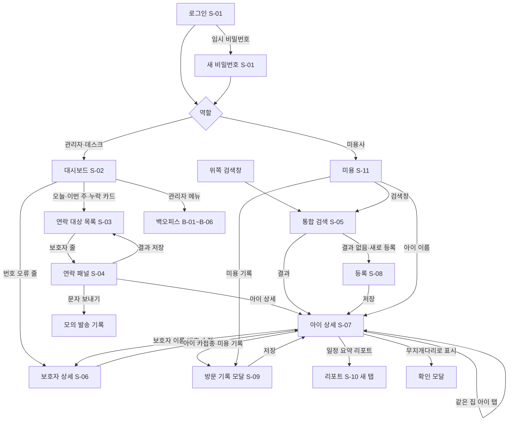

# 화면 설계

| 항목 | 내용 |
| --- | --- |
| 작성 | 양다연 |
| 작성일 | 2026-11-25 |
| 근거 자료 | [업무 분석 - 사용자](../planning/업무%20분석_사용자(2026-11-23).md) 0~5장, [업무 분석 - 백오피스](../planning/업무%20분석_백오피스(2026-11-23).md) 1·2-1·4장, [요구사항 명세서](../planning/요구사항%20명세서(2026-11-23).md) 2·3장, [정책 정의서](../planning/정책%20정의서(2026-11-23).md) 2-8·4장, [팀 결정 기록](../planning/팀%20결정%20기록(2026-11-24).md) T2·T3·T5·T6·T8·K21, 11/25 설계 확정 회의 d1·d4·d5·d6·R1·R6·R9 (정책 정의서 PR #83), [API 설계](./API%20설계(2026-11-24).md) (PR #75), [접종 규칙 표](../planning/접종%20규칙%20표(2026-11-24).md), [화면 프로토타입](https://claude.ai/artifact/NgXpqpHavLrpBYYprMGxSV) |
| 관련 이슈 | #93 |
| 상태 | 초안. 리뷰 중 |
| 수정 | 2026-11-25 초안 작성 (#93) 2026-11-25 8-1 결정 12건 반영: 미용 종류 칸 없음, 대시보드 추이 그래프 · 분포 P3, 대시보드 순서 공통, 아이 프로필 수정은 S-07, 배너 · 이동 · 확인 창, 권한 없음 공통 문구만 (#93) 2026-11-25 PR #104 리뷰 반영 (CodeRabbit, 이종민): 다른 담당 문서가 반영되기 전인 8-1 결정은 '제안', S-11 `groomedToday`, 8-2 16 · 17번과 #108, S-02 지표 정의(POL-MISS-003 · 004), 한국 시간, 2일차 문구 · 다시 시도, 미용사 S-07, 로그아웃 · 사진 API (#93) 2026-11-25 main 합침: #101(PR #113) · #108(PR #112) · #76(PR #106) · API 설계(PR #75) 머지에 맞춰 8-1 '제안 (… 반영 전)'을 확정으로, 8-2 9 · 10 · 11 · 13(요구사항 쪽) · 14 · 17번 풀림. 미용사 타임라인은 미용 줄만(`type=VACCINE` 403). 류다연 리뷰 제안: 4장 흐름 3개, '11/25 회의 R6', 근거 자료 T5 (#93) 2026-11-26 팀 결정 K21 반영: SCR-S04-03에 문자 발송 실패(연락 결과는 저장된 채로, [문자 보내기]로 다시 시도)와 2일차 모의 발송 기록 · 연락 결과 같은 트랜잭션, SCR-S04-04에 정책 4-2 '문자 발송 실패' 문구, 2일차 알림 문구를 4-2 '모의 발송으로 기록하고'로 맞춤 (#140, PR #141 CodeRabbit) 2026-11-26 PR #138 머지에 맞춤: 4-2 '문자 발송 실패' 문구 변경('문자 보내기 버튼으로'), '문자 발송 실패 (2일차)' 문구와 SCR-S04-03 처리, 모의 발송 기록 저장 실패는 '저장 실패', 근거 칸 '(PR #138)' 표시 정리 (#140) 2026-11-26 PR #141 류다연 리뷰 반영: SCR-S04-07에 문자 발송 실패 이동(2일차는 '문자 발송 실패 (2일차)' 안내만, 새 경로 없음), 머리 표 근거 자료에 K21, K21 근거 칸에 '(PR #138 머지됨)' (#140) 2026-11-26 정책 4-2 S-04 문구 반영 (PR #160 리뷰): SCR-S04-04에 '전화 안 받음 2일차 마침' 토스트 2개와 '지난 연락' 빈 목록 문구, SCR-S04-07의 2일차 저장 뒤를 '2일차 마침' 토스트로 (#161) 2026-11-27 S-02 카드 확정 (#156, 양다연): SCR-S02-02 누락 카드는 서비스별이 아니라 누락 아이 수 하나(FR-DASH-001, `summary.missed`), 대상이 0이어도 카드는 숫자로 보임. SCR-S02-03 로딩 문구를 정책 4-2 '숫자 불러오는 중 (S-02)' 인용으로 2026-11-27 S-04 연락 패널 (#153, 양다연): SCR-S04-02 입력 칸은 결과와 상관없이 늘 보임(이슈 남은 질문 결정), SCR-S04-04 비고 '오늘 이미 연락함' 표기 차이 풀림, SCR-S04-03 수신 동의 없으면 연락 방법 '문자'도 꺼짐 2026-11-27 SCR-B01-04 · 07: 임시 비밀번호 모달 문구는 정책 4-2 '임시 비밀번호 (B-01)'로 정해짐, SCR-B01-07에 역할 변경 때 로그아웃(제안), 8-1 12번에서 임시 비밀번호 모달 안내 · 비밀번호 초기화 확인 창을 뺌 (4-2에 생김) (#150, PR #208 양다연 리뷰). 문서 담당 양다연 대신 이종민 작성 2026-11-27 SCR-S06-02 연락 기록 표에 메모 열 (PR #218 실무 반영, #223, 양다연) |

프론트엔드가 화면 하나를 만들 때 이 문서 한 곳만 보면 되도록, 업무 분석(화면 ID·흐름), 요구사항 명세서(FR), 정책 정의서 4장(문구), API 설계(서버 계약), 화면 프로토타입(배치)을 화면별로 모았다. 범위는 직원 화면 S-01~S-11과 백오피스 B-01~B-06이다. 버튼·카드·표 같은 컴포넌트 단위 설계는 컴포넌트 설계 문서에서 따로 다룬다.

---

## 1. 읽는 법

- **표 형식:** 시스템 설계 7장과 같은 `ID | 항목 | 내용 | 결정 상태 | 근거 | 비고`다 (#63).
- **ID:** `SCR-S01-01`, `SCR-COM-01`처럼 이 문서 안에서만 쓰는 항목 번호다. 이슈·커밋·코드 주석에는 FR / NFR / POL ID를 쓴다 (#63).
- **화면마다 행 7개:** `-01` 기본 정보, `-02` 화면 구성, `-03` 상태, `-04` 화면 문구, `-05` 역할별 차이, `-06` 부르는 API, `-07` 화면 이동.
- **결정 상태:** 확정 / 제안(팀 확인 전 권장안) / 미정. 한 행 안에서 부분마다 다르면 `확정(…) / 제안(…)`처럼 나눠 적는다. 프로토타입에만 있고 기획 문서에 없는 배치는 '제안'이다.
- **근거:** FR / NFR / POL ID를 적는다. 이어지는 요구사항이 없으면 '요구사항 근거 없음(설계 결정)'이라고 쓴다.
- **화면 문구:** 정책 정의서 4-2(안내 문구), 4-3(문자 기본 문구), 4-4(화면별 안내 문구)를 그대로 옮겼다. 새로 지은 문구는 없다. 프로토타입 문구가 정책과 다르면 정책 문구를 쓰고 8장에 적었다. 정책에 없는 문구는 8장 '정할 것'에 모았다.
- **다른 PR에 기대는 근거:**
  - **(PR #83)** 11/25 설계 확정 회의 결정(d1 보호자 이름 필수, d4 미용사 쓰기 제한, d5 권한 없음 공통 문구, d6 오류 문구 7개)을 정책 정의서에 반영한 PR이다. 2026-11-25에 머지되어 인용 문구는 main 정책 정의서와 같다.
  - **(PR #75)** [API 설계](./API%20설계(2026-11-24).md)다. 2026-11-25에 머지되어 `-06` 행의 API 이름을 main과 대조했다. API 설계가 아직 '프론트 · 백엔드 담당 리뷰 중'이고 [제안] 표시가 남아 있어 `-06` 행은 '제안'으로 둔다.
  - **(PR #138)** 팀 결정 K19~K22 채택과 정책 정의서 4-2 '문자 발송 실패' · '문자 발송 실패 (2일차)' 문구를 넣은 PR이다. 2026-11-26에 머지되어 SCR-S04-03 · SCR-S04-04의 인용 문구는 main 정책 정의서 · 팀 결정 기록과 같다.

---

## 2. 공통 레이아웃과 처리

| ID | 항목 | 내용 | 결정 상태 | 근거 | 비고 |
| --- | --- | --- | --- | --- | --- |
| SCR-COM-01 | 화면 틀 | 왼쪽 주 메뉴 + 위쪽 바 + 본문. S-01 로그인과 S-10 리포트는 틀 없이 연다 | 제안 (프로토타입) | 요구사항 근거 없음(설계 결정) | - |
| SCR-COM-02 | 주 메뉴 | 대시보드 · 연락 대상(오늘 대상 수 배지) · 검색 · 새로 등록 · 미용. 관리자에게만 '관리자' 구역(직원 관리 · 주기 규칙 · 기준값·선택지 · 문자 문구 · 리포트 양식 · 변경 이력 = B-01~B-06)을 보인다. 미용사에게는 검색 · 미용만 보인다 | 확정(역할별 숨김) / 제안(순서 · 배지) | FR-AUTH-002, POL-ERR-004, POL-ACC-011 | 프로토타입은 관리자 구역을 관리자로 볼 때만 보인다 (8-2 12번, 고침) |
| SCR-COM-03 | 위쪽 바 | 통합 검색창(입력하면 S-05 드롭다운), 로그인한 직원 이름 · 역할, [로그아웃](`POST /api/auth/logout`, PR #75 제안) | 확정 / 제안(API 이름) | FR-SRCH-001, FR-AUTH-003, POL-ACC-008 | 검색창 자리 글자는 프로토타입의 "보호자 · 아이 이름, 번호 뒤 4자리, 초성"을 쓰되 정책에 없는 문구라 미정 (8-1 12번, #103). 정책 4-4의 S-05 문구는 검색창 아래 안내다 (SCR-S05-04) |
| SCR-COM-04 | 화면 크기 | 데스크 PC 가로 1280px 기준, 태블릿 768px까지 반응형 | 확정 | NFR-AVAIL-002 | 프로토타입 아트보드 1440px |
| SCR-COM-05 | 한 줄 안내 | 화면 제목 아래에 무엇을 하는 화면인지 한 줄. 문구는 각 화면 `-04` 행 (정책 4-4) | 확정 | FR-COM-002 | 4-4에 없는 화면은 8-1 12번 |
| SCR-COM-06 | 로딩 | 대시보드 숫자 카드는 로딩 스켈레톤을 먼저 보여준다. 다른 목록 · 상세도 표 자리에 스켈레톤 | 확정(대시보드) / 제안(나머지) | POL-ERR-007, NFR-PERF-001 | - |
| SCR-COM-07 | 조회 실패 | 자동으로 한 번 다시 시도. 그래도 실패하면 "불러오지 못했습니다. 다시 시도해 주세요." + [다시 시도] | 확정 | POL-ERR-001, FR-COM-001 | 정책 4-2 '조회 실패' |
| SCR-COM-08 | 저장 실패 · 두 번 저장 | 자동으로 다시 시도하지 않고 입력을 지우지 않는다. "저장하지 못했습니다. 다시 시도해 주세요." + [다시 시도]. 저장을 두 번 눌러도 기록은 하나만 생긴다 (서버에서 막음, 11/25 회의 R6) | 확정 | POL-ERR-002, FR-COM-001 | 서버 방법은 공통 기반에서 정함 (PR #83) |
| SCR-COM-09 | 필수 항목 빠짐 | 저장 버튼을 끄고 빠진 칸을 빨갛게 표시. "{항목}을(를) 입력해 주세요." | 확정 | POL-ERR-003, FR-CUS-001 | - |
| SCR-COM-10 | 권한 없음 | 메뉴에서 숨긴다. 주소로 직접 들어오면 권한 없음 화면: "이 작업을 할 권한이 없습니다. 필요하면 관리자에게 문의해 주세요." (4-2, 모든 역할 공통) + 그 역할의 첫 화면으로 가는 버튼. 서버는 403 | 확정(문구 · 403) / 제안(돌아가기 버튼) | POL-ERR-004, POL-ACC-011, FR-AUTH-002, NFR-SEC-002 | 프로토타입은 [대시보드로 가기]만 있다. 미용사는 대시보드도 거부라 S-11로 보낸다. 백오피스용 4-4 본문은 쓰지 않는다 (8-1 10번 결정) |
| SCR-COM-11 | 로그인 만료 | 로그인 화면으로 보내고, 다시 로그인하면 보던 화면으로 돌아온다. 로그인 8시간 뒤 자동 로그아웃 | 확정 | POL-ERR-005, POL-ACC-005, FR-AUTH-003 | 문구는 SCR-S01-04 |
| SCR-COM-12 | 빈 상태 | "아직 기록이 없습니다"처럼 빈 상태를 보여준다 | 확정(공통 문구) / 미정(화면별 문구) | POL-ERR-008 | 화면별 빈 목록 문구는 프로토타입에도 문장이 없어 정책 담당이 새로 써서 4-2에 추가한다 (8-1 11번 결정, #103) |
| SCR-COM-13 | 없는 정보 | 지워졌거나 없는 화면 주소: "찾는 정보가 없습니다. 목록에서 다시 찾아 주세요." (PR #83) | 확정 | 요구사항 근거 없음(설계 결정) | 정책 4-2 `NOT_FOUND` (11/25 회의 d6) |
| SCR-COM-14 | 나가기 경고 | 입력 중에 저장하지 않고 나가려 하면 확인 모달 "입력한 내용이 사라집니다." [나가기] [계속 입력] | 확정(문구) / 제안(버튼 이름) | FR-COM-003 | P3. 버튼 이름은 프로토타입 S-08 |
| SCR-COM-15 | 기록 수정 · 수정됨 | 본인이 남긴 연락 · 방문 기록은 남긴 날에만 [수정]. 고친 기록에 '수정됨'을 붙이고 누르면 수정 이력 모달. 고칠 수 없는 기록이면 "본인이 남긴 기록만, 남긴 날에만 고칠 수 있습니다." (PR #83) | 확정 | FR-COM-004, POL-DATA-006, POL-DATA-007 | 수정 창 문구는 SCR-S07-04 |
| SCR-COM-16 | 나눠 보기 | 검색 결과 · 대상 목록 · 타임라인은 20개씩. 지난 연락 전체처럼 당장 필요 없는 정보는 열 때 불러온다 | 확정 | NFR-PERF-002, FR-SRCH-002 | - |
| SCR-COM-17 | 전화번호 표시 | 목록 · 검색 결과는 뒤 4자리(`····-1234`)만. 전체 번호는 S-04 연락 패널 · S-06 보호자 상세에서만 | 확정 | NFR-SEC-003, POL-DATA-002 | - |
| SCR-COM-18 | 저장 성공 알림 | 저장하면 토스트를 띄우고 화면을 갱신한다 | 확정(방식) / 미정(문구 대부분) | 요구사항 근거 없음(설계 결정) | 업무 분석_사용자 4장. 정책 문구는 연락 결과 저장 · 문자 모의 발송 두 개뿐. 나머지는 정책 담당이 판단 (8-1 12번 결정) |
| SCR-COM-19 | 기록한 직원 · 시간 | 모든 기록에 기록한 직원과 시간을 자동으로 붙여 보여준다 | 확정 | NFR-DATA-002, POL-DATA-008 | - |
| SCR-COM-20 | 메모 칸 | 메모 칸 아래 "진료 내용·민감한 정보·감정 표현은 적지 않습니다. (200자까지)", 200자까지만 받고 글자 수 표시 | 확정(안내 · 200자) / 제안(글자 수 표시) | POL-DATA-010, FR-CNT-002 | S-04, S-09에 쓴다 |

---

## 3. 화면 목록

| ID | 화면 | 쓰는 역할 | 열리는 방식 | 관련 요구사항 | 첫 화면 |
| --- | --- | --- | --- | --- | --- |
| S-01 | 로그인 · 새 비밀번호 | 전원 | 페이지 (틀 없음) | FR-AUTH-001, FR-AUTH-003, FR-ADM-007 | - |
| S-02 | 대시보드 | 관리자, 데스크 | 페이지 | FR-DASH-001, FR-DASH-002, FR-DASH-003, FR-DASH-004, FR-DASH-005 | 관리자 · 데스크 |
| S-03 | 연락 대상 목록 | 관리자, 데스크 | 페이지 | FR-TGT-001, FR-TGT-002, FR-TGT-003, FR-TGT-004 | - |
| S-04 | 연락 패널 | 관리자, 데스크 | S-03 오른쪽 사이드 패널 | FR-CNT-001, FR-CNT-002, FR-CNT-003, FR-CNT-005, FR-CNT-006, FR-CNT-007 | - |
| S-05 | 통합 검색 | 전원 | 위쪽 검색창 드롭다운 → 페이지 | FR-SRCH-001, FR-SRCH-002, FR-SRCH-003, FR-SRCH-004 | - |
| S-06 | 보호자 상세 | 관리자, 데스크 | 페이지 | FR-CUS-004, FR-CUS-005, FR-CUS-008 | - |
| S-07 | 아이 상세 · 통합 타임라인 | 전원 (미용사는 읽기(타임라인은 미용 줄만) · 미용 기록만) | 페이지 | FR-VIS-003, FR-CUS-003, FR-CUS-004, FR-CUS-006, FR-CUS-007, FR-CUS-008, FR-COM-004 | - |
| S-08 | 보호자 · 아이 등록 | 관리자, 데스크 | 페이지 | FR-CUS-001, FR-CUS-002, FR-CUS-004, FR-SRCH-004 | - |
| S-09 | 방문 기록 입력 | 접종: 관리자 · 데스크 / 미용: 전원 | 모달 | FR-VIS-001, FR-VIS-002, FR-VIS-004 | - |
| S-10 | 아이 일정 요약 리포트 | 관리자, 데스크 | 새 탭 (A4) | FR-RPT-001, FR-RPT-002 | - |
| S-11 | 미용 | 미용사, 데스크, 관리자 | 페이지 | FR-VIS-002 | 미용사 |
| B-01 | 직원 관리 | 관리자 | 백오피스 탭 | FR-ADM-001, FR-ADM-007 | - |
| B-02 | 주기 규칙 | 관리자 | 백오피스 탭 | FR-ADM-002, FR-ADM-003 | - |
| B-03 | 기준값 · 선택지 | 관리자 | 백오피스 탭 | FR-ADM-004, FR-ADM-005 | - |
| B-04 | 문자 문구 · 병원 정보 | 관리자 | 백오피스 탭 | FR-ADM-008 | - |
| B-05 | 리포트 양식 | 관리자 | 백오피스 탭 | FR-ADM-009 | - |
| B-06 | 변경 이력 | 관리자 | 백오피스 탭 | FR-ADM-006 | - |

---

## 4. 화면 흐름

---

## 5. 직원 화면

### S-01 로그인 · 새 비밀번호

| ID | 항목 | 내용 | 결정 상태 | 근거 | 비고 |
| --- | --- | --- | --- | --- | --- |
| SCR-S01-01 | 기본 정보 | 전원. 페이지(틀 없음). 관련 요구사항: FR-AUTH-001, FR-AUTH-003, FR-ADM-007(임시 비밀번호로 로그인하면 새 비밀번호를 정함) | 확정 | FR-AUTH-001, FR-AUTH-003, FR-ADM-007 | - |
| SCR-S01-02 | 화면 구성 | 가운데 카드 하나: 로고 · 서비스 이름 → [로그인] 카드(아이디, 비밀번호, [로그인], 폼 아래 안내). 임시 비밀번호로 로그인하면 같은 자리에 '새 비밀번호 정하기' 카드(새 비밀번호, 새 비밀번호 확인, 조건 안내, [저장하고 시작하기]) | 확정(입력 항목) / 제안(배치) | FR-AUTH-001, FR-ADM-007, POL-ACC-010 | 프로토타입의 '시연 계정으로 바로 보기' 링크는 시연용이라 넣지 않는다 |
| SCR-S01-03 | 상태 | 처음: 빈 칸. 로그인 실패: 위에 빨간 안내, 비밀번호 칸 빨간 테두리. 실패 횟수로 잠그지 않는다. 세션 만료로 왔을 때: 위에 안내. 임시 비밀번호: 새 비밀번호 카드. 로딩: [로그인]을 누른 동안 버튼을 잠근다. 빈 목록 · 권한 없음: 해당 없음 | 확정 / 제안(로딩) | POL-ACC-006, POL-ERR-005, POL-ACC-010 | - |
| SCR-S01-04 | 화면 문구 | 폼 아래: "비밀번호를 잊었으면 원장이나 데스크 실장에게 초기화를 요청해 주세요. 8시간이 지나면 자동으로 로그아웃됩니다." (4-4) 세션 만료: "다시 로그인해 주세요. 로그인하면 보던 화면으로 돌아갑니다." (4-4) 로그인 실패: "아이디 또는 비밀번호가 맞지 않습니다." (4-2) 임시 비밀번호 로그인: "임시 비밀번호로 로그인했습니다. 새 비밀번호를 정해 주세요." (4-2) 비밀번호 조건: "비밀번호는 8자 이상, 영문과 숫자를 섞어 주세요." (4-2) | 확정 | FR-AUTH-001, FR-AUTH-003, POL-ACC-010 | - |
| SCR-S01-05 | 역할별 차이 | 화면은 같다. 로그인 뒤 첫 화면만 다르다: 관리자 · 데스크 → S-02, 미용사 → S-11 | 확정 | POL-ACC-007, FR-AUTH-001 | 팀 결정 T2 |
| SCR-S01-06 | 부르는 API | `POST /api/auth/login`, `GET /api/auth/me`, `POST /api/auth/password` (새 비밀번호) | 제안 (PR #75) | FR-AUTH-001, FR-AUTH-002, FR-ADM-007 | - |
| SCR-S01-07 | 화면 이동 | [로그인] 성공 → 역할별 첫 화면(만료 뒤 다시 로그인했으면 보던 화면). [저장하고 시작하기] → 역할별 첫 화면 | 확정 | FR-AUTH-001, FR-AUTH-003, POL-ACC-010 | - |

### S-02 대시보드

| ID | 항목 | 내용 | 결정 상태 | 근거 | 비고 |
| --- | --- | --- | --- | --- | --- |
| SCR-S02-01 | 기본 정보 | 관리자 · 데스크. 페이지. 관리자 · 데스크의 로그인 뒤 첫 화면. 관련 요구사항: FR-DASH-001, FR-DASH-002, FR-DASH-003, FR-DASH-004, FR-DASH-005 (FR-DASH-006은 v2, 추이 그래프 · 방문 분포 FR-DASH-007 · 008은 P3) | 확정 | FR-DASH-001, FR-DASH-002, FR-DASH-003, FR-DASH-004, FR-DASH-005, POL-ACC-007 | - |
| SCR-S02-02 | 화면 구성 | 제목 · 한 줄 안내 · 오늘 날짜(한국 시간) ① 오늘 할 일 카드 3개: 오늘 연락 대상('N마리 중 M마리 처리', [오늘 탭 열기]), 이번 주(월~일, 같은 형식), 누락(저장된 누락 판정이 있는 아이 수 하나, [누락 탭 열기]). 대상이 0이어도 '0마리 중 0마리 처리'처럼 숫자로 보인다 (#156). 오늘 · 이번 주는 한국 시간(Asia/Seoul)으로 서버가 판단한다. 누락 판정은 '예정일 + 누락 기준(B-03 설정값, 기본 14일)'이 지났을 때 서버가 저장하고, 카드는 저장된 판정만 센다 ② 재방문 지표: 기간 선택(이번 달 / 지난 3개월 / 직접 선택: 시작일 · 종료일 [적용]), 지표 4개(접종 재방문율(주요 접종만), 미용 재방문율, 접종 누락률(주요 접종만), 예정일 대비 실제 방문 차이(일)). 서비스별로 기간 안에 예정일이 된 주기 중 결과가 정해진 것(방문으로 완료 또는 누락 판정 저장)을 대상으로 아이 기준으로 센다. 한 아이에게 대상 주기가 여럿이면 서비스 · 기간마다 결과를 하나로 정한다: 하나라도 누락 판정이 저장돼 있으면 누락 아이, 하나도 없으면 재방문 아이. 주기마다 따로 세지 않는다. 대시보드와 FR-DASH-002 엑셀 손계산이 같은 규칙을 쓴다. 저장된 누락 판정만 읽고 날짜로 다시 계산하지 않는다. 같은 서비스의 재방문율 + 누락률 = 100%. 심장사상충 · 구충은 두 지표에서 뺀다. 무지개다리 아이 제외 ③ 연락 효과: 연락 결과 유형별 재방문 전환율, 연락 방법(전화 · 문자(모의 발송))별 전환율 ④ 번호 오류 보호자 모음 표: 보호자, 번호(뒤 4자리), 아이, 번호 오류 기록(날짜 · 직원), 마지막 확인 | 확정(영역 · 지표 · 계산 기준 · 순서 ①→④) / 제안(한 아이 여러 주기 규칙 · 세부 배치) | FR-DASH-001, FR-DASH-002, FR-DASH-003, FR-DASH-004, FR-DASH-005, POL-MISS-001, POL-MISS-003, POL-MISS-004, POL-MISS-008, POL-MISS-009, POL-TGT-001 | 계산 기준은 11/25 회의 R1 · R9 (PR #83). 한 아이 여러 주기 규칙은 POL-MISS-003 · 004의 '누락 판정이 없는 아이' / '누락 판정이 저장된 아이'를 문장대로 읽은 것이다. API 설계 3장 · DB 설계 5-4도 같은 규칙을 [제안]으로 두었고, 정책 문장에 적히기 전까지 제안 (8-2 18번). 순서는 업무 분석_사용자 1장에도 반영됨 (#108). 프로토타입의 재방문율 추이 그래프 · 방문 차이 분포 막대는 P3 (FR-DASH-007 · 008, 8-1 2 · 3번 결정) |
| SCR-S02-03 | 상태 | 처음: 기간 '이번 달'. 로딩: 숫자 카드 자리에 스켈레톤과 "숫자를 불러오는 중입니다." (정책 4-2 '숫자 불러오는 중 (S-02)'), 2초 안. 빈: 기록이 없으면 빈 상태 (지표 영역. 카드는 0도 숫자로 보인다). 오류: 공통 조회 실패(SCR-COM-07). 권한 없음: 미용사(SCR-COM-10) | 확정 | POL-ERR-007, NFR-PERF-001, POL-ERR-001, POL-ERR-008, POL-ACC-011 | 로딩 문구는 정책 4-2 '숫자 불러오는 중 (S-02)' 그대로 (#156) |
| SCR-S02-04 | 화면 문구 | 제목 아래: "오늘 연락할 아이와 재방문 숫자를 한 화면에서 봅니다." (4-4) 기간 선택: "페이지를 옮기지 않고 다시 계산합니다" (4-4) 연락 방법별 전환: "전화 안 받음 2일차 뒤 보낸 안내 문자도 문자로 셉니다." (4-4) 번호 오류 모음: "다음 방문 때 아이 상세에 번호 확인 배너가 뜹니다" (4-4) | 확정 | FR-COM-002, FR-DASH-003, FR-DASH-004, FR-DASH-005 | - |
| SCR-S02-05 | 역할별 차이 | 관리자 · 데스크는 같은 화면, 같은 순서('오늘 할 일' 먼저). 미용사는 권한 없음(403) | 확정 | POL-ACC-011, FR-AUTH-002 | 8-1 5번 결정. 업무 분석_사용자 1장도 '지표는 오늘 할 일 아래'로 고쳤다 (#108, PR #112) |
| SCR-S02-06 | 부르는 API | `GET /api/targets/summary` (카드), `GET /api/dashboard/metrics?from=&to=` (지표 · 연락 효과), `GET /api/dashboard/wrong-numbers?page=` (번호 오류) | 제안 (PR #75) | FR-DASH-001, FR-DASH-002, FR-DASH-003, FR-DASH-004, FR-DASH-005 | - |
| SCR-S02-07 | 화면 이동 | 오늘 · 이번 주 · 누락 카드 → S-03 그 탭. 기간 바꾸기 → 페이지 이동 없이 다시 계산. 번호 오류 줄 → S-06 그 보호자 | 확정 | FR-DASH-001, FR-DASH-004, FR-DASH-005, FR-TGT-001 | 번호 오류 줄 → S-06은 8-1 8번 결정 |

### S-03 연락 대상 목록

| ID | 항목 | 내용 | 결정 상태 | 근거 | 비고 |
| --- | --- | --- | --- | --- | --- |
| SCR-S03-01 | 기본 정보 | 관리자 · 데스크. 페이지. 관련 요구사항: FR-TGT-001, FR-TGT-002, FR-TGT-003, FR-TGT-004 | 확정 | FR-TGT-001, FR-TGT-002, FR-TGT-003, FR-TGT-004 | - |
| SCR-S03-02 | 화면 구성 | 제목 · 한 줄 안내 · '예정일이 오래 지난 순' 표시 탭 3개(오늘 N / 이번 주(월~일) N / 누락 N)와 탭 설명. 오늘 · 이번 주는 한국 시간(Asia/Seoul)으로 서버가 판단한다 보호자 단위 한 줄: 보호자 이름, 번호 뒤 4자리, 선호 연락 방법, 주의 태그, 같은 집 아이별 예정 항목(접종은 아이마다 가장 가까운 하나 + 펼치면 나머지, 미용), 예정일 · 지난 날 수, 다음 연락 예정일 결과를 기록한 줄은 '처리됨 · 결과 · 직원'으로 바뀌어 아래로 내려가고 그날은 오늘 탭 아래에 남는다 아래: '1–20 / N가구 · 20개씩', [이전] [다음] 줄을 누르면 오른쪽에 S-04가 열리고 목록은 그대로 | 확정(항목 · 정렬 · 묶음) / 제안(배치) | FR-TGT-001, FR-TGT-002, FR-TGT-004, POL-TGT-001, POL-TGT-010, POL-TGT-011, NFR-PERF-002 | 목록에서 빠지고 다시 올라오는 규칙은 POL-TGT-002~011 |
| SCR-S03-03 | 상태 | 처음: 오늘 탭(대시보드 카드에서 오면 그 탭). 로딩 · 오류: 공통. 빈 탭: 빈 상태. 권한 없음: 미용사 | 확정 / 미정(빈 탭 문구) | FR-TGT-001, POL-ERR-001, POL-ERR-008, POL-ACC-011 | 빈 탭 문구는 정책에 없다 (8-1 11번) |
| SCR-S03-04 | 화면 문구 | 제목 아래: "예정일이 된 아이를 보호자 단위로 묶었습니다. 줄을 누르면 오른쪽에서 연락 결과를 남깁니다." (4-4) | 확정 | FR-COM-002 | - |
| SCR-S03-05 | 역할별 차이 | 관리자 · 데스크는 같다. 미용사는 권한 없음(403) | 확정 | POL-ACC-011, FR-AUTH-002 | - |
| SCR-S03-06 | 부르는 API | `GET /api/targets?tab=today\|week\|missed&page=`, `GET /api/targets/summary` (탭 숫자) | 제안 (PR #75) | FR-TGT-001, FR-TGT-004, FR-DASH-001 | - |
| SCR-S03-07 | 화면 이동 | 보호자 줄 → S-04 패널(목록 유지). 패널에서 저장 → 그 줄 '처리됨' | 확정 | FR-CNT-001, FR-TGT-004 | - |

### S-04 연락 패널

| ID | 항목 | 내용 | 결정 상태 | 근거 | 비고 |
| --- | --- | --- | --- | --- | --- |
| SCR-S04-01 | 기본 정보 | 관리자 · 데스크. S-03 오른쪽 사이드 패널. 화면 이동 없이 패널 안에서 연락 1건을 끝낸다(통화 시간 빼고 30초 안). 관련 요구사항: FR-CNT-001, FR-CNT-002, FR-CNT-003, FR-CNT-005, FR-CNT-006, FR-CNT-007 | 확정 | FR-CNT-001, FR-CNT-002, FR-CNT-003, FR-CNT-005, FR-CNT-006, FR-CNT-007, NFR-USE-001 | - |
| SCR-S04-02 | 화면 구성 | 위: 보호자 이름 · 아이 수 · [아이 상세 →], 전체 번호, 선호 연락 방법, 주의 태그 알림 줄: 오늘 이미 연락함 / 전화 안 받음 2일차 결과 입력: [모든 항목에 같은 결과] 결과 버튼 5개(예약함 / 전화 안 받음 / 거절 / 다른 병원 다님 / 번호 오류), 예정 항목(아이 × 서비스)마다 결과 버튼 5개(기본값은 같은 결과), 통화한 사람(본인 · 가족), 연락 방법(전화 · 문자), 다음 연락 예정일(전화 안 받음이면 기본 1일 뒤), 메모(SCR-COM-20). 입력 칸은 고른 결과와 상관없이 늘 보인다 (업무 분석_사용자 2-1의 결과별 칸 바꾸기는 쓰지 않음, #153), [같은 집 다른 아이에게도 같은 결과 적용] 체크(기본 꺼짐), [문자 보내기] + 문구 미리보기 + [모의 발송으로 기록], [연락 결과 저장] 아래: 지난 연락(날짜, 내용, 직원) 확인 창 2개: 야간 문자 경고([취소] [그래도 보내기]), 전화 안 받음 2일차(수신 동의 있음: [취소] [문자 보내고 마치기] / 수신 동의 없음: [취소] [문자 없이 마치기]) | 확정(입력 항목) / 제안(배치 · 버튼 이름) | FR-CNT-001, FR-CNT-002, FR-CNT-003, FR-CNT-005, FR-CNT-006, FR-CNT-007, POL-CNT-002, POL-CNT-003, POL-CNT-004, POL-TGT-006 | 결과 유형 5가지는 고정값 (NFR-DATA-003). 같은 집 일괄 적용 · 문구 미리보기는 P3 |
| SCR-S04-03 | 상태 | 처음: 결과를 고르기 전이라 [연락 결과 저장] 꺼짐. 로딩 · 오류: 공통. 지난 연락 없음: 빈 상태. 저장 실패: 입력 유지. 문자 수신 동의 없음: [문자 보내기]와 연락 방법 '문자' 꺼짐 + 안내(동의 없는 보호자에게 문자로 연락한 기록을 남기지 않음, #153). 밤 9시~아침 8시(한국 시간 Asia/Seoul): 보내기 전 경고 창(보낼 수는 있음). 2일차: 저장 전 확인 창. 수신 동의가 없으면 [문자 없이 마치기]를 누를 때 문자를 보내지 않고 '2일 연속 미응답 · 이번 주기 연락 종료'로 기록하고 이번 주기 연락을 마친다. 2일차 [문자 보내고 마치기]의 저장 실패: 모의 발송 기록과 연락 결과 중 하나만 저장된 채로 끝나지 않게 하고(둘은 같은 트랜잭션에 저장, K21), [다시 시도]해도 그 동작의 모의 발송 기록은 하나만 남는다. 문자 발송 실패: `SmsSender` 호출만 실패하면 연락 결과는 저장된 채로 두고 되돌리지 않는다. 4-2 '문자 발송 실패' 안내를 보여 주고, 직원은 [문자 보내기]로 다시 시도한다. 2일차 자동 문자가 실패하면 주기가 끝나(`CLOSED`) 다시 보낼 곳이 없으므로 4-2 '문자 발송 실패 (2일차)' 안내를 보여 준다. 모의 발송 기록 저장이 실패하면 연락 결과도 저장되지 않으므로 '저장 실패'(SCR-COM-08)로 처리한다 (K21). 권한 없음: 미용사 | 확정 / 제안(처음 저장 버튼 꺼짐 · 2일차 다시 시도 규칙) | FR-CNT-005, POL-REG-010, POL-CNT-006, POL-CNT-007, POL-TGT-006, POL-ERR-002, FR-COM-001, 팀 결정 K21 (PR #138 머지됨) | 2일차 다시 시도 규칙은 SCR-COM-08(두 번 저장 막기)을 모의 발송까지 넓힌 것. 모의 발송이 두 번 남으면 대시보드 연락 방법별 전환율(SCR-S02-02)이 틀어진다. MVP는 모의 발송이라 `SmsSender`가 실패하는 경우가 없다. 문자 발송 실패 처리는 실제 발송(v2)을 위한 자리다 (K21) |
| SCR-S04-04 | 화면 문구 | 문자 버튼 아래: "실제로 보내지 않고 모의 발송으로 기록합니다" (4-4) 2일차 확인 창(수신 동의 있음): "문자는 실제로 보내지 않고 모의 발송으로 기록합니다. 다음 주기 예정일이 되면 다시 대상에 올라옵니다." (4-4) 저장 성공: "연락 결과를 저장했습니다." (4-2) 문자 모의 발송: "문자를 보낸 것으로 기록했습니다 (모의 발송)." (4-2) 문자 발송 실패: "연락 결과는 저장했습니다. 문자는 보내지 못했습니다. 문자 보내기 버튼으로 다시 시도해 주세요." (4-2) 문자 발송 실패 (2일차): "연락 결과는 저장했습니다. 안내 문자는 보내지 못했습니다. 필요하면 보호자에게 직접 연락해 주세요." (4-2) 오늘 이미 연락함: "오늘 {직원}이 {시간}에 연락했습니다." (4-2) 수신 동의 없음: "안내 문자 수신에 동의하지 않은 보호자입니다. 전화로 연락해 주세요." (4-2) 야간 문자 경고: "지금은 밤 9시~아침 8시입니다. 접종·미용 안내 문자는 병원 운영 시간에 보내 주세요." (4-2) 전화 안 받음 2일차(수신 동의 있음): "이틀 연속 받지 않았습니다. 안내 문자를 모의 발송으로 기록하고 이번 주기 연락을 마칩니다." (4-2) 2일차(수신 동의 없음): "이틀 연속 받지 않았습니다. 문자 수신 동의가 없어 문자 없이 이번 주기 연락을 마칩니다." (4-2) 전화 안 받음 2일차 마침 (토스트): "문자를 보낸 것으로 기록하고 이번 주기 연락을 마쳤습니다 (모의 발송)." (4-2). 2일차 [문자 보내고 마치기]에서는 이 토스트 하나만 띄운다 ('문자 모의 발송' 토스트를 따로 띄우지 않음, 4-2) 전화 안 받음 2일차 마침 (수신 동의 없음, 토스트): "문자 없이 이번 주기 연락을 마쳤습니다." (4-2) 지난 연락 없음 (빈 목록): "이 보호자에게 남긴 연락 기록이 없습니다." (4-2) 2일차 알림 줄은 수신 동의에 따라 위 4-2 두 문구 중 하나만 쓴다. 2일차 확인 창은 수신 동의가 있으면 4-2 '(수신 동의 있음)' 문구와 4-4 확인 창 문구를 함께 쓰고, 수신 동의가 없으면 4-2 '(수신 동의 없음)' 문구만 쓴다. 수신 동의가 없으면 문자를 보낸다는 문구는 어디에도 쓰지 않는다 문자 미리보기: 접종 안내 · 미용 안내 기본 문구 (4-3, B-04에서 고친 값). 2일차 안내 문자는 접종과 미용 예정 항목이 섞여 있으면 접종 안내 문구를 쓴다 (POL-TGT-006, 팀 결정 T4) | 확정 | FR-CNT-001, FR-CNT-003, FR-CNT-005, FR-CNT-007, POL-CNT-005, POL-CNT-006, POL-CNT-007, POL-TGT-006, POL-ERR-008, 팀 결정 T4, 팀 결정 K21 (PR #138 머지됨) | '오늘 이미 연락함' 표기 차이는 풀림 (8-2 9번). 화면은 정책 4-2 문구를 쓴다 |
| SCR-S04-05 | 역할별 차이 | 관리자 · 데스크는 같다. 미용사는 패널을 열 수 없다(403) | 확정 | POL-ACC-011, FR-AUTH-002 | - |
| SCR-S04-06 | 부르는 API | `GET /api/guardians/{id}/contact-panel`, `GET /api/guardians/{id}/contacts?page=`, `POST /api/contacts`, `POST /api/contacts/sms/preview`, `POST /api/contacts/sms` | 제안 (PR #75) | FR-CNT-001, FR-CNT-002, FR-CNT-005, FR-CNT-007 | - |
| SCR-S04-07 | 화면 이동 | [연락 결과 저장] → 토스트, S-03의 그 줄 '처리됨', 다음 보호자로 넘어갈지 묻는다. [아이 상세 →] → S-07. [문자 보내기] → (밤이면 경고 창) → 미리보기 → 모의 발송 기록 (`SmsSender` 호출만 실패하면 4-2 '문자 발송 실패' 안내, 패널에 남아 [문자 보내기]로 다시 시도). 전화 안 받음 2일차에 [연락 결과 저장] → 2일차 확인 창: [문자 보내고 마치기] → (밤이면 경고 창) → 모의 발송 기록 · 저장, 이번 주기 연락 끝 (`SmsSender` 호출만 실패하면 주기가 `CLOSED`라 다시 보낼 곳이 없으므로 4-2 '문자 발송 실패 (2일차)' 안내만 보여 주고 새 경로를 만들지 않는다) / [문자 없이 마치기](수신 동의 없음) → 문자 없이 '2일 연속 미응답 · 이번 주기 연락 종료'로 저장, 이번 주기 연락 끝 / [취소] → 저장하지 않고 패널로 돌아간다(입력 유지). 2일차 두 경우는 '저장 성공' 토스트 대신 4-2 '전화 안 받음 2일차 마침' 토스트(문자 없이 마치면 '(수신 동의 없음)' 토스트)를 띄운다. `SmsSender` 호출만 실패하면 이 토스트 대신 '문자 발송 실패 (2일차)'를 띄운다. 그 밖의 저장 뒤 동작(S-03의 그 줄 '처리됨', 다음 보호자 묻기)은 [연락 결과 저장]과 같다 | 확정(저장 뒤 · 2일차 처리) / 제안(다음 보호자 묻기) | FR-CNT-002, FR-TGT-004, FR-CNT-003, FR-CNT-005, POL-TGT-006, POL-CNT-007, 팀 결정 T4, 팀 결정 K21 (PR #138 머지됨) | 다음 보호자 묻기는 업무 분석_사용자 2-1 7단계 |

### S-05 통합 검색

| ID | 항목 | 내용 | 결정 상태 | 근거 | 비고 |
| --- | --- | --- | --- | --- | --- |
| SCR-S05-01 | 기본 정보 | 전원. 위쪽 검색창 드롭다운 → Enter면 결과 페이지. 관련 요구사항: FR-SRCH-001, FR-SRCH-002, FR-SRCH-003, FR-SRCH-004 | 확정 | FR-SRCH-001, FR-SRCH-002, FR-SRCH-003, FR-SRCH-004 | - |
| SCR-S05-02 | 화면 구성 | 드롭다운: 입력하는 동안 결과 미리보기(아이 이름 · 품종, 보호자 이름 · 번호 뒤 4자리) + 'Enter로 전체 결과 보기' 결과 페이지: 제목 · 한 줄 안내 → 검색어 칸 → 결과 요약('{검색어}' 결과 N건 · 20개씩) → 결과 줄(아이 이름, 품종 · 나이(추정이면 표시), 보호자 이름, 번호 뒤 4자리, 상태 배지(예정 지남 · 오늘 접종 · 누락 · 번호 오류 · 무지개다리), 같은 집 아이). 무지개다리 아이는 회색 | 확정(결과 항목) / 제안(배지 · 배치) | FR-SRCH-001, FR-SRCH-002, POL-END-002, NFR-SEC-003 | 프로토타입의 '예시' 버튼은 시연용이라 넣지 않는다 |
| SCR-S05-03 | 상태 | 처음: 빈 검색어. 로딩: 입력을 멈춘 뒤 0.5초 안에 미리보기. 결과 많음: 안내 문구. 결과 없음: 안내 + [새로 등록]. 오류: 공통. 권한 없음: 해당 없음 | 확정 | NFR-PERF-003, FR-SRCH-004, POL-ERR-001 | - |
| SCR-S05-04 | 화면 문구 | 검색창 아래: "번호 뒤 4자리, 보호자·아이 이름, 초성으로 찾습니다. 띄어쓰기와 하이픈은 무시합니다." (4-4) 결과 없음 아래: "검색어가 번호면 전화번호 칸에, 이름이면 이름 칸에 미리 채웁니다." (4-4) 검색 결과 없음: "'{검색어}'로 찾은 보호자가 없습니다. 새로 등록할까요?" (4-2) 검색 결과 많음: "번호 뒤 4자리를 함께 넣으면 더 빨리 찾을 수 있습니다." (4-2) | 확정 | FR-SRCH-001, FR-SRCH-004, FR-COM-002 | - |
| SCR-S05-05 | 역할별 차이 | 미용사도 같은 검색을 쓰고 결과를 누르면 S-07(읽기). 미용사에게는 [새로 등록]을 숨긴다(등록 거부). 관리자 · 데스크는 같다 | 확정 | POL-ACC-011, FR-AUTH-002 | - |
| SCR-S05-06 | 부르는 API | `GET /api/search/preview?q=`, `GET /api/search?q=&page=` | 제안 (PR #75) | FR-SRCH-001, FR-SRCH-002, FR-SRCH-003 | - |
| SCR-S05-07 | 화면 이동 | 결과 줄 → S-07. [새로 등록] → S-08(검색어를 번호 칸 또는 이름 칸에 미리 채움). 드롭다운에서 Enter → 결과 페이지 | 확정 | FR-SRCH-001, FR-SRCH-004 | - |

### S-06 보호자 상세

| ID | 항목 | 내용 | 결정 상태 | 근거 | 비고 |
| --- | --- | --- | --- | --- | --- |
| SCR-S06-01 | 기본 정보 | 관리자 · 데스크. 페이지. 관련 요구사항: FR-CUS-004(보호자 항목: 보조 연락처 · 선호 연락 방법), FR-CUS-005, FR-CUS-008(아이 프로필 수정 빼고) | 확정 | FR-CUS-004, FR-CUS-005, FR-CUS-008 | FR-CUS-004의 아이 항목(체중 · 등록번호 · 펫보험 · 사진)은 S-07 [수정]에서 채운다 (8-1 6번) |
| SCR-S06-02 | 화면 구성 | 경로(검색 › 보호자 이름) → 제목 '{이름} 보호자' · 한 줄 안내 · [보호자 정보 수정] 연락처 카드: 전화번호(전체) · 마지막 확인 날짜, 보조 연락처, 선호 연락 방법, 동의(개인정보 수집·이용 · 안내 문자 수신, 날짜), 등록일 · 등록 직원. 수정 모드: 보호자 이름, 전화번호, 보조 연락처, 선호 연락 방법, [취소] [저장] 주의 태그 카드: 4가지를 눌러서 붙이고 뗀다 같은 집 아이 카드: 이름, 상태 배지, 품종 · 털 유형 · 나이, 다음 예정, [아이 상세 →]. 무지개다리 아이는 회색 + 표시 날짜 · 보류 날짜, 관리자에게만 [무지개다리 표시 되돌리기] 연락 기록 표: 날짜, 아이 · 항목, 방법, 통화한 사람, 결과, 메모, 기록 직원 | 확정(항목) / 제안(배치) | FR-CUS-004, FR-CUS-005, FR-CUS-008, POL-REG-008, POL-REG-009, POL-END-004 | 아이 프로필 수정은 S-07 프로필 카드 [수정]에서 한다 (8-1 6번 결정, FR-CUS-008은 #101로 반영). 정책 4-4는 아직 S-06으로 적혀 있다 (8-2 13번, #103) |
| SCR-S06-03 | 상태 | 처음: 보기 모드. 수정 모드: 입력 칸. 로딩 · 오류: 공통. 연락 기록 없음: 빈 상태. 저장 실패: 입력 유지. 되돌리기: 확인 모달. 권한 없음: 미용사 | 확정 | FR-CUS-008, POL-ERR-002, POL-ERR-008, POL-ACC-011 | - |
| SCR-S06-04 | 화면 문구 | 제목 아래: "연락처와 주의 태그, 같은 집 아이를 관리합니다. 전체 번호는 이 화면과 연락 패널에서만 보입니다." (4-4) 무지개다리 아이: "되돌리기는 관리자만 할 수 있습니다." (4-4) 되돌리기 확인: "{이름}의 무지개다리 표시를 되돌리면 연락 대상과 통계에 다시 들어가고, 같은 집 연락 보류가 풀립니다." (4-2) 연락 보류: "{날짜}까지 연락 보류" (4-2) | 확정 | FR-CUS-008, POL-END-004, POL-TGT-003 | 4-4 '아이 프로필 수정' 문구는 SCR-S07-04로 옮겼다. 프로토타입의 태그 · 번호 변경 안내 문장은 정책에 없다 (8-1 12번) |
| SCR-S06-05 | 역할별 차이 | 관리자: [무지개다리 표시 되돌리기]가 보인다. 데스크: 그 자리에 안내 문구. 미용사: 권한 없음(보호자 전체 번호 · 정보 수정 거부) | 확정 | POL-END-004, POL-ACC-011, FR-CUS-008 | 11/25 회의 d4 (PR #83) |
| SCR-S06-06 | 부르는 API | `GET /api/guardians/{id}`, `PATCH /api/guardians/{id}` (정보 · 주의 태그), `POST /api/pets/{id}/rainbow-revert`, `GET /api/guardians/{id}/contacts?page=` | 제안 (PR #75) | FR-CUS-005, FR-CUS-008 | - |
| SCR-S06-07 | 화면 이동 | 아이 카드 → S-07. 경로 '검색' → S-05. [무지개다리 표시 되돌리기] → 확인 모달 → 저장 뒤 카드 갱신 | 확정 | FR-CUS-003, FR-CUS-008 | S-06으로 오는 길: S-07 보호자 영역, S-02 번호 오류 줄(제안) |

### S-07 아이 상세 · 통합 타임라인

| ID | 항목 | 내용 | 결정 상태 | 근거 | 비고 |
| --- | --- | --- | --- | --- | --- |
| SCR-S07-01 | 기본 정보 | 전원(미용사는 읽기(타임라인은 미용 줄만) · 미용 기록만). 페이지. 관련 요구사항: FR-VIS-003, FR-CUS-003, FR-CUS-004(아이 항목: 체중 · 등록번호 · 펫보험 · 사진), FR-CUS-006, FR-CUS-007, FR-CUS-008(아이 프로필 수정), FR-COM-004 | 확정 | FR-VIS-003, FR-CUS-003, FR-CUS-004, FR-CUS-006, FR-CUS-007, FR-CUS-008, FR-COM-004 | 아이 프로필 수정 위치는 8-1 6번 결정 (FR-CUS-008에 반영, #101) |
| SCR-S07-02 | 화면 구성 | 경로(검색 › 보호자 › 아이) → 같은 집 아이 탭 → 번호 확인 배너([확인함] [번호 수정]) 프로필 카드: 이름, 상태 배지(재방문 관리 중 / 무지개다리), '생년월일 추정' 표시, 품종, 털 유형, 생년월일 · 나이, 체중, 등록번호, 펫보험, 보호자 이름 · 번호 뒤 4자리 · 선호 연락 · 수신 동의. 연락 보류 중이면 보류 날짜. [수정] → 아이 프로필 수정(이름 · 생년월일 · 품종 · 털 유형 · 체중 · 등록번호 · 펫보험 · 사진 등, [취소] [저장]) 버튼: [접종 기록] [미용 기록] [일정 요약 리포트] [무지개다리로 표시] 다음 예정일 카드: 접종 종류마다 따로(이름, 날짜, 남은 날 · 지난 날, 누락이 되는 날), 미용(개인 미용 주기와 계산 근거) 통합 타임라인: 필터(전체 / 접종 / 미용 / 연락), 줄마다 날짜, 구분, 내용, 배지(전환 · 누락), 기록 직원 · 시간, '수정됨', [수정]. 20개씩 모달: S-09 방문 기록, 수정 이력, 기록 수정, 무지개다리 확인 | 확정(항목 · 프로필 [수정]) / 제안(배치) | FR-VIS-003, FR-CUS-003, FR-CUS-004, FR-CUS-006, FR-CUS-007, FR-CUS-008, FR-CYC-001, FR-CYC-002, FR-CYC-003, FR-CYC-004, POL-REG-004, POL-REG-009 | 누락 접종은 빨간 표시 (FR-VIS-003). 프로필 [수정]은 8-1 6번 결정 |
| SCR-S07-03 | 상태 | 로딩 · 오류: 공통. 타임라인 없음: 빈 상태. 번호 확인 배너: 마지막 확인 1년 지남 또는 '번호 오류' 보호자. 무지개다리 아이: 회색 표시, 연락 · 기록 버튼을 숨긴다. 권한 없음: 해당 없음(미용사는 일부만) | 확정 | FR-CUS-006, POL-REG-008, POL-END-002, POL-ERR-008 | - |
| SCR-S07-04 | 화면 문구 | 아이 프로필 수정: "아이 프로필을 바꾸면 예정일을 다시 계산합니다" (4-4, 정책에는 S-06에 적혀 있음) 타임라인 아래: "20개씩 보여줍니다 · 모든 기록에 기록한 직원과 시간이 자동으로 붙습니다." (4-4) 기록 수정 창: "본인이 남긴 기록만, 남긴 날에만 고칠 수 있습니다. 고치면 이전 값이 이력으로 남습니다." (4-4) 번호 확인: "번호를 확인해 주세요 (마지막 확인: {날짜})" (4-2) 번호 오류 보호자 방문: "번호 오류로 표시된 보호자입니다. 새 번호를 확인해 주세요." (4-2) 연락 보류: "{날짜}까지 연락 보류" (4-2) 무지개다리 변경: "{이름}를 무지개다리로 표시하면 모든 연락 대상과 통계에서 빠집니다. 같은 집 다른 아이는 {보류 기간}일 동안 연락을 보류합니다." (4-2) 기록 수정 표시: "수정됨" (4-2) | 확정 | FR-VIS-003, FR-CUS-006, FR-CUS-007, FR-COM-004, POL-END-001, POL-END-003 | {보류 기간}은 B-03 값 (팀 결정 T6). 프로토타입도 기준값을 쓰도록 고쳤다 (8-2 3번) |
| SCR-S07-05 | 역할별 차이 | 미용사: 프로필 · 다음 예정일(접종 상태 · 누락 빨간 표시 포함) · 미용 타임라인을 읽고, [미용 기록]만 쓴다. 접종 상태는 다음 예정일 카드로만 보고 접종 기록 줄(메모 포함)은 보지 않는다. 타임라인에서는 본인이 오늘 남긴 미용 기록에만 [수정]이 보인다(서버 `editable`). 숨김: 프로필 [수정], [접종 기록], [일정 요약 리포트], [무지개다리로 표시], 타임라인 필터(미용 줄만 나오므로), 연락 · 접종 기록 줄, 번호 확인 배너, 보호자 이름의 S-06 링크(이름은 글자로만 보인다). 관리자 · 데스크는 같다 | 확정(읽기 · 숨김) / 제안(당일 본인 미용 기록 수정) | POL-ACC-011, FR-AUTH-002, POL-DATA-006, FR-COM-004 | 11/25 회의 d4 (PR #83). 미용사 타임라인 미용 줄만은 API 설계 2장 · 3장 (POL-ACC-011 '아이 상세 읽기: 미용 이력 · 접종 상태'). 배너 숨김은 8-1 7번 결정 (배너 버튼이 부르는 API가 미용사 거부). S-06 링크는 미용사가 S-06 권한 없음이라 숨긴다 (7장). 당일 본인 미용 기록 수정은 API 설계 2장 `PATCH /api/visits/{id}` [제안] |
| SCR-S07-06 | 부르는 API | `GET /api/pets/{id}`, `PATCH /api/pets/{id}` (프로필 수정), `POST /api/pets/{id}/photo` (프로필 수정의 사진), `GET /api/pets/{id}/timeline?type=&page=` (미용사가 `type=CONTACT` · `type=VACCINE`으로 부르면 403, `type=ALL`이면 미용 줄만 준다. 화면에서 필터를 숨기는 것만으로는 막지 못하므로 서버가 막는다), `POST /api/guardians/{id}/phone-confirm`, `POST /api/pets/{id}/rainbow`, `PATCH /api/visits/{id}`, `PATCH /api/contacts/{id}`, `GET /api/edit-history?targetType=&targetId=` (미용사는 미용 기록 이력만. 접종 방문 · 연락 기록 이력은 403), `GET /api/options/settings` ({보류 기간}) | 제안 (PR #75) / 확정(미용사 연락 · 접종 기록 거부) | FR-VIS-003, FR-CUS-006, FR-CUS-007, FR-COM-004, POL-ACC-011, FR-AUTH-002 | 이슈 #08의 남은 질문과 다르다 (8-2 15번) |
| SCR-S07-07 | 화면 이동 | 같은 집 아이 탭 → 그 아이 S-07. 프로필 [수정] → 같은 화면에서 수정, 저장하면 예정일 다시 계산. [접종 기록] · [미용 기록] → S-09 모달. [일정 요약 리포트] → S-10 새 탭. [무지개다리로 표시] → 확인 모달. 보호자 이름 · [번호 수정] → S-06(관리자 · 데스크만. 미용사에게는 링크 · 배너가 없다). '수정됨' → 수정 이력 모달 | 확정 / 제안(보호자 이름 · [번호 수정] → S-06) | FR-CUS-003, FR-VIS-001, FR-VIS-002, FR-RPT-001, FR-CUS-007, FR-CUS-008, FR-COM-004, POL-ACC-011 | - |

### S-08 보호자 · 아이 등록

| ID | 항목 | 내용 | 결정 상태 | 근거 | 비고 |
| --- | --- | --- | --- | --- | --- |
| SCR-S08-01 | 기본 정보 | 관리자 · 데스크. 페이지. 관련 요구사항: FR-CUS-001, FR-CUS-002, FR-CUS-004, FR-SRCH-004 | 확정 | FR-CUS-001, FR-CUS-002, FR-CUS-004, FR-SRCH-004 | - |
| SCR-S08-02 | 화면 구성 | 제목 · 한 줄 안내 보호자: 전화번호*, 보호자 이름*. 같은 번호면 경고 박스(기존 아이 목록) + [기존 보호자에 아이 추가] [새로 등록] 아이: 이름*, 동물 종류(강아지 고정), 생년월일*(날짜 / 모름 · 대략 나이: 개월 또는 살 → 추정 생년월일), 품종*, 털 유형*(단모 · 중모 · 장모 · 곱슬) 선택 항목: 보조 연락처(가족), 선호 연락 방법, 현재 체중, 병원 등록번호, 펫보험, 사진 동의: 개인정보 수집·이용, 안내 문자 수신 [저장] [취소]. 오른쪽: 저장하면 만들어지는 예정일 미리보기 필수(*)는 6개 | 확정(항목 · 필수 6개) / 제안(배치 · 예정일 미리보기) | FR-CUS-001, FR-CUS-002, FR-CUS-004, POL-REG-001, POL-REG-002, POL-REG-003, POL-REG-004, POL-REG-005, POL-REG-007, POL-REG-010 | 보호자 이름 필수는 11/25 회의 d1 (PR #83). 프로토타입도 6칸으로 고쳤다 (8-2 1번) |
| SCR-S08-03 | 상태 | 처음: S-05에서 오면 검색어를 번호 또는 이름 칸에 미리 채움. 필수 빠짐: [저장] 꺼짐 + 빠진 칸 빨갛게. 같은 번호: 경고 박스. 저장 실패: 입력 유지, [다시 시도]해도 보호자 · 아이는 한 번만 저장된다. 사진만 실패: 등록은 끝난 것으로 보고 사진만 다시 올린다(SCR-S08-06). 나가기: 경고 모달. 권한 없음: 미용사 | 확정 / 제안(사진만 실패) | FR-SRCH-004, FR-CUS-002, POL-ERR-002, POL-ERR-003, FR-COM-003, POL-ACC-011 | - |
| SCR-S08-04 | 화면 문구 | 제목 아래: "필수 6칸만 채우면 저장할 수 있습니다. 나머지는 나중에 보호자 상세에서 채웁니다." (4-4, PR #83) 대략 나이: "1살 미만은 개월 수, 그 이상은 나이로 받습니다. 오늘에서 뺀 날을 생년월일로 쓰고 '추정' 표시를 붙입니다." (4-4) 품종·털 유형: "품종·털 유형은 정해진 선택지에서만 고릅니다. 목록은 백오피스에서 관리합니다." (4-4) 문자 수신 동의: "동의하지 않으면 문자 보내기 버튼이 꺼집니다. 전화 연락은 할 수 있습니다." (4-4) 저장 뒤: "첫 접종·미용을 기록하면 예정일이 다시 계산됩니다." (4-4) 같은 번호: "이미 등록된 보호자입니다: {보호자 이름} (아이 {N}마리)" (4-2) 필수 항목: "{항목}을(를) 입력해 주세요." (4-2) 나가기 경고: "입력한 내용이 사라집니다." (4-2) | 확정 | FR-CUS-001, FR-CUS-002, FR-COM-003, POL-REG-001, POL-REG-004, POL-REG-010 | 제목 아래 문구의 '나중에 보호자 상세에서 채웁니다'는 아이 항목을 S-07 [수정]에서 채우기로 한 8-1 6번과 어긋난다. 문구는 정책 그대로 인용하고 정책 담당이 고친다 (8-2 16번, #103) |
| SCR-S08-05 | 역할별 차이 | 관리자 · 데스크는 같다. 미용사는 권한 없음(403) | 확정 | POL-ACC-011, FR-AUTH-002 | - |
| SCR-S08-06 | 부르는 API | `GET /api/guardians/phone-check?phone=`, `POST /api/guardians` (새 보호자: 보호자와 첫 아이를 한 요청으로 함께 저장), `POST /api/guardians/{id}/pets` ([기존 보호자에 아이 추가]일 때만), `GET /api/options/breeds`, `GET /api/options/coat-types`, `POST /api/pets/{id}/photo` (사진. 아이를 저장해 id가 생긴 뒤 올린다) 다시 시도: 보호자 · 아이 저장은 요청 하나라 보호자만 저장되는 일이 없다. 저장 실패 뒤 [다시 시도]는 같은 요청을 다시 보내고 서버가 한 번만 저장한다(11/25 회의 R6). 아이 저장은 됐는데 사진만 실패하면 등록을 다시 보내지 않고, 처음 받은 `petId`로 사진만 다시 올린다 | 제안 (PR #75) / 확정(두 번 저장 막기) | FR-CUS-001, FR-CUS-002, FR-CUS-004, POL-REG-002, POL-REG-007, POL-ERR-002 | 한 요청 저장 · 두 번 저장 막기는 PR #75 3장 `POST /api/guardians`와 1-5. 같은 요청을 알아보는 방법은 #13에서 정한다 |
| SCR-S08-07 | 화면 이동 | [저장] → S-07(새 아이). [기존 보호자에 아이 추가] → 그 보호자 아래에 아이를 붙이는 모드(보호자 정보는 바꾸지 않음). [취소] · 다른 메뉴 → 입력이 있으면 나가기 경고 | 확정 | FR-CUS-001, FR-CUS-002, FR-COM-003 | - |

### S-09 방문 기록 입력

| ID | 항목 | 내용 | 결정 상태 | 근거 | 비고 |
| --- | --- | --- | --- | --- | --- |
| SCR-S09-01 | 기본 정보 | 접종: 관리자 · 데스크 / 미용: 전원. S-07 · S-11 위 모달. 관련 요구사항: FR-VIS-001, FR-VIS-002, FR-VIS-004 | 확정 | FR-VIS-001, FR-VIS-002, FR-VIS-004 | - |
| SCR-S09-02 | 화면 구성 | 제목 '{아이 이름} 방문 기록', 구분(접종 / 미용) 접종: 접종 종류(선택지, 심장사상충 · 구충 예방약 포함), 방문 날짜(오늘로 채움) 미용: 미용 날짜(오늘로 채움), 메모 공통: 데려온 사람 번호(주 보호자와 다를 때만), 메모(SCR-COM-20) 저장하면 바뀔 다음 예정일 미리보기, [취소] [저장] | 확정(항목, 미용 종류 칸 없음) / 제안(배치 · 예정일 미리보기) | FR-VIS-001, FR-VIS-002, FR-VIS-004, POL-REG-006 | 미용 종류(전체 · 부분 · 목욕 등)는 칸을 두지 않고 메모에 적는다 (8-1 1번 결정). 프로토타입에는 아직 칸이 있다 |
| SCR-S09-03 | 상태 | 처음: 날짜는 오늘. 필수 빠짐: [저장] 꺼짐. 저장 실패: 모달 안에 안내, 입력 유지. 무지개다리 아이: 기록 버튼이 없고, 서버도 거부한다. 미용사: 접종 구분 꺼짐 | 확정 | FR-VIS-001, FR-VIS-002, POL-ERR-002, POL-END-002, POL-ACC-011 | - |
| SCR-S09-04 | 화면 문구 | 미용 저장: "기록하면 다음 미용 예정일을 다시 계산합니다." (4-4) 메모 칸: "진료 내용·민감한 정보·감정 표현은 적지 않습니다. (200자까지)" (4-2) 저장 실패: "저장하지 못했습니다. 다시 시도해 주세요." (4-2) 무지개다리 아이에게 기록: "무지개다리로 표시된 아이라 기록을 남길 수 없습니다. 기록이 필요하면 관리자에게 표시 되돌리기를 요청해 주세요." (4-2, PR #83) 나가기 경고: "입력한 내용이 사라집니다." (4-2) | 확정 | FR-VIS-002, FR-COM-001, FR-COM-003, POL-DATA-010, POL-END-002 | 접종 저장 문구는 4-4에 없다 (8-1 12번) |
| SCR-S09-05 | 역할별 차이 | 미용사는 미용만 기록한다(접종 기록 403). 관리자 · 데스크는 둘 다 | 확정 | POL-ACC-011, FR-AUTH-002 | - |
| SCR-S09-06 | 부르는 API | `POST /api/pets/{petId}/visits`, `GET /api/options/vaccine-types` | 제안 (PR #75) | FR-VIS-001, FR-VIS-002, FR-VIS-004 | - |
| SCR-S09-07 | 화면 이동 | [저장] → 모달 닫힘, 토스트, S-07 타임라인 맨 위에 새 기록 + 다음 예정일 갱신(S-11에서 열었으면 S-11 목록 갱신). [취소] → 입력이 있으면 나가기 경고 | 확정 | FR-VIS-001, FR-VIS-002, FR-CYC-003, FR-COM-003 | - |

### S-10 아이 일정 요약 리포트

| ID | 항목 | 내용 | 결정 상태 | 근거 | 비고 |
| --- | --- | --- | --- | --- | --- |
| SCR-S10-01 | 기본 정보 | 관리자 · 데스크. 새 탭, A4 한 장. 관련 요구사항: FR-RPT-001, FR-RPT-002 (양식은 FR-ADM-009) | 확정 | FR-RPT-001, FR-RPT-002, FR-ADM-009 | - |
| SCR-S10-02 | 화면 구성 | 머리: 병원 이름, 제목, 발행일, 보호자 이름 아이 정보: 품종, 생년월일(나이), 털 유형, 개인 미용 주기 다음 예정일 표: 항목, 예정일, 상태(지난 예정일은 안내와 함께) 지난 접종 · 미용 표: 날짜, 구분, 내용(기간은 B-05 설정) 병원에서 드린 안내: 연락 기록 요약(날짜 · 방법 · 결과) 아래: 안내 문구, 예약용 병원 전화번호 담는 항목 · 제목 · 기간 · 아래 문구는 B-05를 따른다. 화면에는 [출력] 버튼(브라우저 인쇄) | 확정(항목) / 제안(배치 · [출력] 위치) | FR-RPT-001, FR-RPT-002, POL-RPT-001, POL-RPT-002, POL-RPT-003 | 진료 내용은 담지 않는다. 프로토타입에는 [출력] 버튼이 없다 |
| SCR-S10-03 | 상태 | 로딩 · 오류: 공통. 항목에 기록이 없으면 그 칸에 빈 상태. 권한 없음: 미용사 | 확정 | POL-ERR-001, POL-ERR-008, POL-ACC-011 | - |
| SCR-S10-04 | 화면 문구 | 4-4에 이 화면 문구는 없다. 리포트 안 글자는 설정값 기본값을 쓴다: 제목 '{아이 이름}의 일정 요약', 아래 안내 '진료 내용은 이 요약에 담지 않습니다. 예정일은 아이의 기록으로 계산한 날짜입니다.' (POL-RPT-001, 팀 결정 T5) | 확정(설정 기본값) / 미정(4-4 문구) | POL-RPT-001, FR-ADM-009 | 8-1 12번 |
| SCR-S10-05 | 역할별 차이 | 관리자 · 데스크는 같다. 미용사는 권한 없음(리포트 거부) | 확정 | POL-ACC-011, FR-AUTH-002 | 11/25 회의 d4 (PR #83) |
| SCR-S10-06 | 부르는 API | `GET /api/reports/{petId}` | 제안 (PR #75) | FR-RPT-001 | - |
| SCR-S10-07 | 화면 이동 | S-07 [일정 요약 리포트] → 새 탭. [출력] → 브라우저 인쇄 | 확정 | FR-RPT-001, FR-RPT-002 | - |

### S-11 미용

| ID | 항목 | 내용 | 결정 상태 | 근거 | 비고 |
| --- | --- | --- | --- | --- | --- |
| SCR-S11-01 | 기본 정보 | 미용사 · 데스크 · 관리자. 페이지. 미용사의 로그인 뒤 첫 화면. 관련 요구사항: FR-VIS-002 | 확정 | FR-VIS-002, POL-ACC-007, POL-ACC-011 | 오늘 · 이번 주 미용 예정 목록은 FR-VIS-002에 들어갔다 (#77, PR #85) |
| SCR-S11-02 | 화면 구성 | 제목 · 한 줄 안내 왼쪽 '미용 예정 목록': 탭(오늘 N / 이번 주(월~일) N), 아이 찾기, 줄마다 아이 이름, 품종 · 털 유형 · 나이 · 보호자 이름(번호 뒤 4자리), 배지(오늘 · 미용 완료). 오늘 · 이번 주 기준(한국 시간 Asia/Seoul)과 정렬(예정일이 오래 지난 순)은 연락 대상 목록과 같다. 오늘 미용을 기록한 아이는 '미용 완료'로 목록 아래에 남는다(`groomedToday`). 누락된 미용 주기를 오늘 탭에 넣을지와 '누락' 배지는 미정 오른쪽 선택한 아이: 이름 · 설명, 보호자 주의 태그, 다음 미용 예정 · 개인 주기와 계산 근거, 접종 상태(보기만), 미용 이력(날짜, 내용, 미용사), [미용 기록] | 확정(탭 · 기준 · 정렬 · 번호 뒤 4자리) / 제안(배치 · 오늘 미용한 아이 남기기) / 미정(누락 미용) | FR-VIS-002, FR-TGT-001, FR-CYC-002, POL-TGT-001, POL-ACC-011, NFR-SEC-003 | PR #75는 누락 미용도 오늘 탭에 넣는 쪽([제안])이고, 넣을지는 #25 담당과 정한다 (PR #75 7장 6번) |
| SCR-S11-03 | 상태 | 처음: 오늘 탭, 첫 아이 선택. 로딩 · 오류: 공통. 빈 탭: 빈 상태. 저장 뒤: 그 줄 '미용 완료' | 확정(공통) / 미정(빈 탭 문구) | POL-ERR-001, POL-ERR-008 | 8-1 11번 |
| SCR-S11-04 | 화면 문구 | 제목 아래: "오늘·이번 주 미용 예정 아이를 보고, 미용이 끝나면 바로 기록합니다. 접종 상태는 보기만 할 수 있어요." (4-4) 미용 기록: "기록하면 다음 미용 예정일을 다시 계산합니다." (4-4) | 확정 | FR-COM-002, FR-VIS-002 | - |
| SCR-S11-05 | 역할별 차이 | 미용사: 이 화면과 검색만 쓴다. 데스크 · 관리자도 연다. 데스크 · 관리자는 S-09에서 접종도 기록할 수 있다 | 확정 | POL-ACC-007, POL-ACC-011 | - |
| SCR-S11-06 | 부르는 API | `GET /api/grooming?tab=today\|week&page=` (PR #75에서도 [제안]. 오늘 미용한 아이는 `groomedToday = true`로 함께 온다), `GET /api/pets/{id}`, `GET /api/pets/{id}/timeline?type=&page=`, `POST /api/pets/{petId}/visits` | 제안 (PR #75) | FR-VIS-002, FR-VIS-003 | 타임라인은 미용사 요청이라 미용 줄만 온다 (SCR-S07-06). 오른쪽 '접종 상태(보기만)'는 `GET /api/pets/{id}`의 다음 예정일로 보여준다. '오늘 미용 기록' 조회 API(`GET /api/visits/today`)는 PR #75에서 빠지고 `groomedToday`가 대신한다 |
| SCR-S11-07 | 화면 이동 | 목록 줄 → 오른쪽 상세. [미용 기록] → S-09(미용). 아이 이름 → S-07. 위쪽 검색창 → S-05 | 확정([미용 기록] · 검색) / 제안(아이 이름 → S-07) | FR-VIS-002, FR-SRCH-001 | - |

---

## 6. 백오피스 화면

B-01~B-06은 한 페이지('백오피스 · 관리자') 안의 탭 6개다. 왼쪽 메뉴의 관리자 구역 6개가 각 탭을 연다. 모두 관리자만 열고, 다른 역할은 권한 없음 화면(SCR-COM-10)을 보며 서버는 403이다 (FR-AUTH-002, NFR-SEC-002). 백오피스 프로토타입은 [화면 프로토타입](https://claude.ai/artifact/NgXpqpHavLrpBYYprMGxSV)의 '백오피스' 페이지다.

### B-01 직원 관리

| ID | 항목 | 내용 | 결정 상태 | 근거 | 비고 |
| --- | --- | --- | --- | --- | --- |
| SCR-B01-01 | 기본 정보 | 관리자. 백오피스 탭. 관련 요구사항: FR-ADM-001, FR-ADM-007 | 확정 | FR-ADM-001, FR-ADM-007 | - |
| SCR-B01-02 | 화면 구성 | 탭 제목 · 안내 → [직원 추가] → 직원 표: 이름, 아이디, 역할, 상태(사용 중 / 비활성), 마지막 로그인, [비밀번호 초기화]. 비활성 직원 줄에는 남긴 기록이 그대로 보인다는 표시. 역할 바꾸기 · 비활성화는 줄에서 직원 추가 모달: 이름, 아이디, 역할(데스크 / 미용사 / 관리자), [취소] [추가] → 임시 비밀번호 모달(한 번만 보임, [확인]) | 확정(항목) / 제안(배치) | FR-ADM-001, FR-ADM-007, POL-ACC-001, POL-ACC-004, POL-ACC-010 | 비밀번호 초기화는 P3 |
| SCR-B01-03 | 상태 | 처음: 직원 목록(관리자 1명은 기본 데이터). 로딩 · 오류: 공통. 아이디 중복: 추가 막음 + 안내. 저장 실패: 입력 유지 | 확정 | FR-ADM-001, POL-ACC-009, POL-ERR-002 | - |
| SCR-B01-04 | 화면 문구 | 목록 위: "직원마다 자기 계정을 씁니다. 퇴사하면 지우지 않고 비활성화합니다. 비밀번호는 8자 이상, 영문과 숫자를 섞습니다." (4-4) 직원 추가: "추가하면 임시 비밀번호가 한 번 보입니다. 직원은 첫 로그인 때 새 비밀번호를 정합니다." (4-4) 이미 쓰는 아이디: "이미 쓰는 아이디입니다. 다른 아이디를 입력해 주세요." (4-2, PR #83) | 확정 | FR-ADM-001, FR-ADM-007, POL-ACC-003, POL-ACC-004 | 임시 비밀번호 모달: "임시 비밀번호는 이 화면에서 한 번만 보입니다. 직원에게 전달하면 첫 로그인 때 새 비밀번호를 정하게 됩니다." (정책 4-2 '임시 비밀번호 (B-01)', #150) |
| SCR-B01-05 | 역할별 차이 | 관리자만 | 확정 | FR-AUTH-002, POL-ACC-002 | - |
| SCR-B01-06 | 부르는 API | `GET /api/admin/staff`, `POST /api/admin/staff`, `PATCH /api/admin/staff/{id}`, `POST /api/admin/staff/{id}/reset-password` | 제안 (PR #75) | FR-ADM-001, FR-ADM-007 | - |
| SCR-B01-07 | 화면 이동 | [직원 추가] → 추가 모달 → 임시 비밀번호 모달. [비밀번호 초기화] → 확인 창 → 임시 비밀번호 모달. 비활성화 · 초기화 · 역할 변경을 하면 그 직원이 로그인해 둔 모든 기기에서 로그아웃된다 | 확정 | FR-ADM-001, FR-ADM-007, POL-ACC-004, POL-ACC-010 | 로그아웃은 11/25 회의 R5 (PR #83). 역할 변경은 제안 (#150, API 설계 3-10). 확인 창 문구는 정책 4-2 '비밀번호 초기화 확인 (B-01)' (#183) |

### B-02 주기 규칙

| ID | 항목 | 내용 | 결정 상태 | 근거 | 비고 |
| --- | --- | --- | --- | --- | --- |
| SCR-B02-01 | 기본 정보 | 관리자. 백오피스 탭. 관련 요구사항: FR-ADM-002, FR-ADM-003 | 확정 | FR-ADM-002, FR-ADM-003 | - |
| SCR-B02-02 | 화면 구성 | 접종 규칙 표: 접종 종류, 나이 구간, 기초접종, 추가접종 간격, 주요 접종(주요 / 선택 / 연락만 · 누락률 제외) → 저장 버튼 위 안내 미용 기본 간격: 털 유형 4가지 × 주 → [변경 저장] | 확정(항목) / 제안(배치) | FR-ADM-002, FR-ADM-003, POL-CYC-001, POL-CYC-002, POL-MISS-004 | 처음 값은 [접종 규칙 표](../planning/접종%20규칙%20표(2026-11-24).md) 문서를 따른다. 프로토타입 값은 옛 초안이다 (8-2 4번) |
| SCR-B02-03 | 상태 | 로딩 · 오류: 공통. 값이 비었거나 0 이하: 저장 막음 + 안내. 저장 실패: 입력 유지 | 확정 | POL-ERR-006, POL-ERR-002 | - |
| SCR-B02-04 | 화면 문구 | 저장 버튼 위: "규칙을 바꾸면 아직 오지 않은 예정일만 다시 계산합니다. 지난 예정일과 누락 판정·통계는 그대로 둡니다." (4-4) 주요 접종 표시: "'주요 접종'만 접종 누락률에 들어갑니다" (4-4) 규칙 값이 비었거나 0 이하: "값이 비었거나 0 이하라 저장하지 못했습니다. 1 이상의 숫자를 입력해 주세요." (4-2) | 확정 | FR-ADM-002, FR-CYC-003, POL-CYC-005, POL-ERR-006 | - |
| SCR-B02-05 | 역할별 차이 | 관리자만 | 확정 | FR-AUTH-002, POL-ACC-002 | - |
| SCR-B02-06 | 부르는 API | `GET` · `PUT /api/admin/vaccine-rules`, `GET` · `PUT /api/admin/coat-types/intervals` | 제안 (PR #75) | FR-ADM-002, FR-ADM-003 | - |
| SCR-B02-07 | 화면 이동 | [변경 저장] → 토스트, 아직 오지 않은 예정일 다시 계산, B-06에 이력 | 확정 | FR-CYC-003, FR-ADM-006 | - |

### B-03 기준값 · 선택지

| ID | 항목 | 내용 | 결정 상태 | 근거 | 비고 |
| --- | --- | --- | --- | --- | --- |
| SCR-B03-01 | 기본 정보 | 관리자. 백오피스 탭. 관련 요구사항: FR-ADM-004, FR-ADM-005 | 확정 | FR-ADM-004, FR-ADM-005 | - |
| SCR-B03-02 | 화면 구성 | 기준값: 누락 기준(일), 무지개다리 후 같은 집 연락 보류(일) 품종 · 털 유형 선택지: 목록, [선택지 추가] 모달(종류: 품종 / 털 유형, 이름, 털 유형이면 미용 기본 간격(주)) → [변경 저장] | 확정(항목) / 제안(배치) | FR-ADM-004, FR-ADM-005, POL-MISS-001, POL-END-003, POL-REG-002 | 선택지 관리는 P3 |
| SCR-B03-03 | 상태 | 값이 비었거나 0 이하: 저장 막음 + 안내. 같은 선택지: 추가 막음. 로딩 · 오류: 공통 | 확정 / 미정(같은 선택지 문구) | FR-ADM-004, POL-ERR-006 | 프로토타입 '이미 있는 선택지입니다.'는 정책에 없다 (8-1 12번) |
| SCR-B03-04 | 화면 문구 | 누락 기준: "예정일 + 이 날짜가 지나도록 방문이 없으면 누락. 전환 인정 기간도 같이 바뀝니다" (4-4) 연락 보류 기간: "같은 집 다른 아이를 이 기간 동안 연락 대상에서 뺍니다" (4-4) 규칙 값이 비었거나 0 이하: "값이 비었거나 0 이하라 저장하지 못했습니다. 1 이상의 숫자를 입력해 주세요." (4-2) | 확정 | FR-ADM-004, POL-MISS-005, POL-END-003 | - |
| SCR-B03-05 | 역할별 차이 | 관리자만 | 확정 | FR-AUTH-002, POL-ACC-002 | - |
| SCR-B03-06 | 부르는 API | `GET` · `PUT /api/admin/settings`, `GET /api/admin/breeds`, `POST /api/admin/breeds`, `PATCH /api/admin/breeds/{id}`, `POST /api/admin/coat-types`, `PATCH /api/admin/coat-types/{id}` | 제안 (PR #75) | FR-ADM-004, FR-ADM-005 | - |
| SCR-B03-07 | 화면 이동 | [변경 저장] → 토스트, B-06에 이력. 누락 기준을 바꿔도 이미 판정한 누락은 그대로다 | 확정 | FR-ADM-006, POL-MISS-001 | 판정 결과 저장은 11/25 회의 R1 (PR #83) |

### B-04 문자 문구 · 병원 정보

| ID | 항목 | 내용 | 결정 상태 | 근거 | 비고 |
| --- | --- | --- | --- | --- | --- |
| SCR-B04-01 | 기본 정보 | 관리자. 백오피스 탭. 관련 요구사항: FR-ADM-008 (쓰는 곳 FR-CNT-007) | 확정 | FR-ADM-008, FR-CNT-007 | P3 |
| SCR-B04-02 | 화면 구성 | 병원 정보: 병원 이름, 병원 전화번호 문구 2개(접종 안내 문자 / 미용 안내 문자)마다: 쓰는 곳, [기본 문구로 되돌리기], 문구 입력, 칸 넣기 버튼({병원 이름} {아이 이름} {접종 종류} {예정일} {병원 전화번호}), 글자 수와 단문(SMS) · 장문(LMS) 표시, 예시 아이('보리') 미리보기, 안내 → [문구 저장] | 확정(항목) / 제안(배치) | FR-ADM-008, POL-CNT-005 | - |
| SCR-B04-03 | 상태 | {아이 이름}이나 {예정일}이 빠지면 저장 막음 + 안내. 로딩 · 오류: 공통 | 확정 | FR-ADM-008, POL-CNT-005 | - |
| SCR-B04-04 | 화면 문구 | 미리보기 아래: "진료 내용이나 가격은 넣지 않습니다. 21시~다음 날 8시에는 보내기 전에 경고가 뜨고, 실제로 보내지 않고 모의 발송으로 기록합니다. 전화 안 받음 2일차 뒤 보내는 문자도 이 문구를 씁니다." (4-4) 문자 문구에 필수 칸 빠짐: "필수 칸이 빠져 저장하지 못했습니다. 문구에 '{아이 이름}'과 '{예정일}'을 넣어 주세요." (4-2) 기본 문구: 접종 안내 "[{병원 이름}] {아이 이름}의 {접종 종류} 접종 예정일은 {예정일}입니다. 방문 전 {병원 전화번호}로 예약해 주세요.", 미용 안내 "[{병원 이름}] {아이 이름}의 다음 미용 예정일은 {예정일} 무렵입니다. 원하시는 날짜를 {병원 전화번호}로 알려 주세요." (4-3) | 확정 | FR-ADM-008, POL-CNT-005 | - |
| SCR-B04-05 | 역할별 차이 | 관리자만 | 확정 | FR-AUTH-002, POL-ACC-002 | - |
| SCR-B04-06 | 부르는 API | `GET` · `PUT /api/admin/message-templates`, `POST /api/admin/message-templates/{code}/reset`, `GET` · `PUT /api/admin/hospital` | 제안 (PR #75) | FR-ADM-008 | - |
| SCR-B04-07 | 화면 이동 | [문구 저장] → 토스트, 다음 문자부터 S-04 미리보기에 반영. 병원 정보는 S-10 리포트에도 쓴다. B-06에 이력 | 확정 | FR-ADM-008, FR-ADM-006, POL-RPT-001 | - |

### B-05 리포트 양식

| ID | 항목 | 내용 | 결정 상태 | 근거 | 비고 |
| --- | --- | --- | --- | --- | --- |
| SCR-B05-01 | 기본 정보 | 관리자. 백오피스 탭. 관련 요구사항: FR-ADM-009 (쓰는 곳 FR-RPT-001) | 확정 | FR-ADM-009, FR-RPT-001 | P3 |
| SCR-B05-02 | 화면 구성 | 왼쪽 설정: 제목({아이 이름} 넣기), 담을 항목 4개 체크(아이 정보, 다음 예정일, 지난 접종·미용, 병원에서 드린 안내) + 꺼진 체크 '진료 내용·수의사 상담·홈케어 안내'(고를 수 없음), 지난 이력 기간(최근 1년 / 최근 2년 / 전체), 아래 안내 문구 → [양식 저장] 오른쪽: A4 미리보기(고르는 대로 바뀜) | 확정(항목) / 제안(배치 · 기간 선택지) | FR-ADM-009, POL-RPT-001, POL-RPT-002 | - |
| SCR-B05-03 | 상태 | 항목을 모두 끄면 저장 막음 + 안내. 로딩 · 오류: 공통 | 확정 | FR-ADM-009, POL-RPT-001 | - |
| SCR-B05-04 | 화면 문구 | 리포트 항목 모두 끔: "고른 항목이 없어 저장하지 못했습니다. 리포트에 담을 항목을 하나 이상 골라 주세요." (4-2) 기본값: 제목 '{아이 이름}의 일정 요약', 지난 이력 기간 최근 1년, 아래 안내 '진료 내용은 이 요약에 담지 않습니다. 예정일은 아이의 기록으로 계산한 날짜입니다.' (POL-RPT-001) 4-4에 이 탭의 안내 문구는 없다 | 확정 / 미정(4-4 문구) | FR-ADM-009, POL-RPT-001 | 8-1 12번 |
| SCR-B05-05 | 역할별 차이 | 관리자만 | 확정 | FR-AUTH-002, POL-ACC-002 | - |
| SCR-B05-06 | 부르는 API | `GET` · `PUT /api/admin/report-template` | 제안 (PR #75) | FR-ADM-009 | - |
| SCR-B05-07 | 화면 이동 | [양식 저장] → 토스트, S-10에 반영, B-06에 이력 | 확정 | FR-ADM-009, FR-ADM-006 | - |

### B-06 변경 이력

| ID | 항목 | 내용 | 결정 상태 | 근거 | 비고 |
| --- | --- | --- | --- | --- | --- |
| SCR-B06-01 | 기본 정보 | 관리자. 백오피스 탭. 관련 요구사항: FR-ADM-006 '설정 변경 이력' | 확정 | FR-ADM-006 | P3 |
| SCR-B06-02 | 화면 구성 | 표: 언제, 누가, 항목, 이전 값, 바꾼 값. 최근 순, 20개씩. 대상: 접종 규칙 표, 미용 기본 간격, 기준값(누락 기준 · 연락 보류 기간), 품종 · 털 유형 선택지, 문자 문구 · 병원 정보, 리포트 양식 | 확정(대상 · 열) / 제안(정렬 · 20개씩) | FR-ADM-006, FR-ADM-005, NFR-DATA-002, POL-DATA-008 | 선택지 변경도 남기는 것은 8-1 4번 결정. FR-ADM-006 대상에 들어갔다 (#101, PR #113) |
| SCR-B06-03 | 상태 | 이력이 없으면 빈 상태. 로딩 · 오류: 공통. 읽기만 한다 | 확정 | POL-ERR-008, POL-ERR-001 | - |
| SCR-B06-04 | 화면 문구 | 4-4에 이 탭의 안내 문구는 없다. 빈 상태는 공통(SCR-COM-12) | 미정 | FR-COM-002 | 8-1 12번 |
| SCR-B06-05 | 역할별 차이 | 관리자만 | 확정 | FR-AUTH-002, POL-ACC-002 | - |
| SCR-B06-06 | 부르는 API | `GET /api/admin/rule-history?page=` | 제안 (PR #75) | FR-ADM-006 | API 설계도 '설정 변경 이력'으로 부른다. 경로 이름 `rule-history`만 다르다 (8-2 6번) |
| SCR-B06-07 | 화면 이동 | 이동 없음 (보기만) | 확정 | FR-ADM-006 | - |

---

## 7. 역할별 접근 표

`O` 쓸 수 있음, `일부` 일부만, `X` 권한 없음(메뉴 숨김 · 서버 403). 근거: POL-ACC-011, FR-AUTH-002, POL-END-004, 11/25 회의 d4 (PR #83).

| 화면 | 관리자 | 데스크 | 미용사 |
| --- | --- | --- | --- |
| S-01 로그인 | O | O | O |
| S-02 대시보드 | O | O | X |
| S-03 연락 대상 목록 | O | O | X |
| S-04 연락 패널 | O | O | X |
| S-05 통합 검색 | O | O | 일부 ([새로 등록] 없음) |
| S-06 보호자 상세 | O (무지개다리 되돌리기 포함) | 일부 (되돌리기 없음) | X |
| S-07 아이 상세 | O | O | 일부 (읽기 · 타임라인은 미용 줄만, [미용 기록], 당일 본인 미용 기록 수정(제안)) |
| S-08 보호자 · 아이 등록 | O | O | X |
| S-09 방문 기록 입력 | O | O | 일부 (미용만) |
| S-10 일정 요약 리포트 | O | O | X |
| S-11 미용 | O | O | O (첫 화면) |
| B-01~B-06 백오피스 | O | X | X |

---

## 8. 정한 것 · 문서끼리 어긋난 곳

### 8-1. 정한 것 (2026-11-25)

화면 설계를 쓰면서 나온 12건을 화면 설계 담당(양다연)이 화면 프로토타입과 기획 문서를 대조하며 2026-11-25에 정했다. 다른 문서를 고쳐야 하는 것은 '남은 일' 칸에 적었다. 다른 담당 문서를 바꿔야 하는 결정(2 · 3 · 4 · 5 · 6번)은 그 문서가 반영되기 전까지 화면별 행에서 '제안'으로 두고, 반영되면 '확정'으로 올린다. 요구사항 명세서(#101, PR #113)와 업무 분석_사용자(#108, PR #112)가 2026-11-25에 머지되어 2 · 3 · 4 · 5 · 6번을 '확정'으로 올렸다. 정책 정의서 쪽(#103)은 화면 문구 자리라 화면 행의 결정 상태에는 영향이 없다.

| 번호 | 정할 것 | 결정 | 반영한 곳 | 남은 일 |
| --- | --- | --- | --- | --- |
| 1 | 미용 기록에 '미용 종류' 칸(전체 · 부분 · 목욕만)을 둘지 | 두지 않는다. 메모에 적는다 | SCR-S09-02 | 프로토타입 S-09 칸 빼기 |
| 2 | 대시보드 재방문율 추이 그래프(날짜별 꺾은선 + '목표 70%' 선) | P3로 미룬다 | SCR-S02-02 | 반영됨: FR-DASH-007 (#101, PR #113) |
| 3 | 대시보드 예정일 대비 실제 방문 분포 막대 | P3로 미룬다 | SCR-S02-02 | 반영됨: FR-DASH-008 (#101, PR #113) |
| 4 | B-06에 품종 · 털 유형 선택지 변경도 남길지 | 남긴다 | SCR-B06-02 | 반영됨: FR-ADM-006 (#101, PR #113) |
| 5 | 대시보드에서 데스크와 원장의 영역 순서를 다르게 할지 | 같은 순서('오늘 할 일' 먼저). 역할별 배치는 만들 일만 늘어난다 | SCR-S02-02, SCR-S02-05 | 반영됨: 업무 분석_사용자 1장 (#108, PR #112) |
| 6 | 아이 프로필 수정을 어디서 여는지 | 아이 상세(S-07) 프로필 카드에 [수정]을 둔다 | SCR-S06-02, SCR-S07-02 · 04 · 05 · 06 · 07 | FR-CUS-008 반영됨 (#101, PR #113). 남은 것: 정책 4-4의 화면 표기 (8-2 13번, #103) · 정책 4-4 S-08 문구 (8-2 16번, #103), 프로토타입 S-07에 [수정] |
| 7 | 미용사에게 S-07 번호 확인 배너를 숨길지 | 숨긴다 | SCR-S07-05 | - |
| 8 | 대시보드 번호 오류 줄을 누르면 어디로 가는지 | 보호자 상세(S-06)로 간다 | SCR-S02-07 | - |
| 9 | [비밀번호 초기화] 전에 확인 창을 둘지 | 둔다 | SCR-B01-07 | 확인 창 문구 (12번, #103) |
| 10 | 권한 없음 화면에 백오피스용 4-4 본문을 계속 쓸지 | 빼고 공통 문구만 쓴다 | SCR-COM-10 | 정책 4-4 '권한 없음 본문' 행 (#103), 프로토타입 권한 없음 본문 |
| 11 | 화면별 빈 목록 문구 (S-03 빈 탭, S-11 빈 탭, S-04 지난 연락 없음 등) | 프로토타입에도 문장이 없어 정책 담당이 새로 써서 4-2에 추가한다 | SCR-COM-12 | 정책 담당 (#103 3번) |
| 12 | 정책에 없는 그 밖의 문구: 검색창 자리 글자, 저장 토스트, 대시보드 로딩 문구, S-06 태그 · 번호 변경 안내, 같은 선택지 오류, 한 줄 안내가 없는 화면(S-09 접종, S-10, B-05, B-06) | 프로토타입 문장을 그대로 4-2 · 4-4에 올릴지 정책 담당이 판단한다 | SCR-COM-03, SCR-COM-05, SCR-COM-18 | 정책 담당 (#103) |

S-11 미용 목록은 FR-VIS-002에 들어갔다 (#77, PR #85 머지).

### 8-2. 문서끼리 어긋난 곳 (저장소 문서는 고치지 않고 보고만)

1 · 2 · 3 · 5 · 9번의 프로토타입 쪽은 2026-11-25에 정책 정의서 문구로 고쳤다 (프로토타입 버전 214). 6 · 12번의 프로토타입 쪽은 요구사항 명세서에 맞춰 고쳤다 (버전 215). 1 · 2번의 정책 정의서 쪽은 PR #83 머지(2026-11-25)로 풀렸다. 9 · 13(요구사항 쪽) · 14번은 #101(PR #113), 10번은 #76(PR #106), 11 · 17번은 #108(PR #112) 머지로 풀렸다 (2026-11-25).

| 번호 | 어디 | 내용 | 이 문서가 따른 것 |
| --- | --- | --- | --- |
| 1 | ~~정책 4-4 · 프로토타입 S-08~~ 둘 다 풀림 | "필수 5칸", 보호자 이름 필수 아님 | 11/25 회의 d1 필수 6칸 (PR #83) |
| 2 | ~~정책 4-2 · 프로토타입 권한 없음~~ 둘 다 풀림 | "이 화면은 관리자만 볼 수 있습니다." | 11/25 회의 d5 공통 문구 (PR #83) |
| 3 | ~~프로토타입 S-07 무지개다리 모달~~ 고침 | 보류 기간이 '30일'로 고정 | 정책 4-2 {보류 기간} (팀 결정 T6) |
| 4 | 프로토타입 B-02 | 접종 규칙 값(인플루엔자 생후 12주 · 2~3회 등)이 옛 초안 | 접종 규칙 표 문서 |
| 5 | ~~프로토타입 B-03 · B-04 · B-05~~ 고침 | 오류 문구가 11/25 회의 d6 문구와 다름 | 정책 4-2 (PR #83) |
| 6 | ~~API 설계 · 프로토타입 B-06~~ 이름은 둘 다 풀림 | '규칙 변경 이력'. API 설계(PR #75)도 '설정 변경 이력'으로 바꿨고 경로 이름 `rule-history`만 남았다 | FR-ADM-006 '설정 변경 이력' (#69). 경로는 API 설계를 따른다 |
| 7 | 프로토타입 S-09 | '미용 종류' 칸 | FR-VIS-002. 칸을 두지 않기로 정함 (8-1 1번) |
| 8 | 프로토타입 S-02 | 재방문율 추이 그래프(기간 안 날짜별 꺾은선, 목표 70% 선), 예정일 대비 실제 방문 분포 막대(예정일 전 / 0~7일 늦게 / 8~14일 늦게 / 안 옴·누락). 연락 퍼널은 스크립트에 계산만 남아 있고 화면에는 나오지 않는다 | FR-DASH-002 · 003 범위만 적음. 그래프 · 분포는 P3 (FR-DASH-007 · 008, 8-1 2 · 3번). 목표선은 넣지 않는다 (FR-DASH-007) |
| 9 | ~~FR-CNT-001 · 프로토타입 S-04~~ 둘 다 풀림 | '오늘 이미 연락함' 표기가 4-2와 다름 ("오늘 {직원}이 {시간}에 연락함") | 정책 4-2 |
| 10 | ~~업무 분석_사용자 2-0~~ 풀림 | 로그인 뒤 첫 화면 "S-02 또는 S-05" | 팀 결정 T2 · POL-ACC-007 (S-11). #76 (PR #106) |
| 11 | ~~업무 분석_사용자 3장 · 5장~~ 풀림 | 무지개다리 보류 '30일' 고정 표기 일부 | 정책 4-2 {보류 기간}. #108 (PR #112) |
| 12 | ~~프로토타입 S-02 · S-03 · S-05 · S-07 · S-08~~ 고침 | 데스크 계정 화면에 관리자 메뉴 구역이 보임 | FR-AUTH-002 (관리자에게만) |
| 13 | ~~요구사항 FR-CUS-008~~ 풀림 (#101, PR #113), 정책 4-4 S-06 | 아이 프로필 수정을 보호자 상세(S-06)에 둠 | 아이 상세(S-07) 프로필 카드 [수정] (8-1 6번). 정책 쪽은 #103 |
| 14 | ~~요구사항 FR-ADM-006~~ 풀림 (#101, PR #113) | 변경 이력 대상에 품종 · 털 유형 선택지가 없음 | 선택지 변경도 남김 (8-1 4번) |
| 15 | 이슈 #08 '남은 질문' | 미용사 계정 타임라인에 연락 기록을 보여줄지 아직 열려 있음 | POL-ACC-011 · FR-AUTH-002: 미용사는 연락 · 접종 기록을 볼 수 없다. 서버가 `type=CONTACT` · `type=VACCINE`은 403, `type=ALL`이면 미용 줄만 준다 (SCR-S07-06, API 설계 3장) |
| 16 | 정책 4-4 S-08 제목 아래 | "나머지는 나중에 보호자 상세에서 채웁니다." 선택 항목 중 아이 항목(체중 · 등록번호 · 펫보험 · 사진)도 보호자 상세에서 채우는 것으로 읽힌다 | 보호자 항목은 S-06, 아이 항목은 S-07 [수정]에서 채운다 (8-1 6번). 정책 담당이 고친다 (#103) |
| 17 | ~~업무 분석_사용자 1장~~ 풀림 | 원장 첫 화면 '대시보드 (지표가 맨 위)' | 역할과 상관없이 같은 순서, '오늘 할 일' 먼저 (8-1 5번). #108 (PR #112) |
| 18 | 정책 POL-MISS-003 · 004, 요구사항 FR-DASH-002 | 한 아이에게 같은 서비스 · 기간의 대상 주기가 여럿이고 결과가 섞일 때(하나는 완료, 하나는 누락) 아이를 어느 쪽으로 셀지 명시하지 않음. API 설계 3장 · DB 설계 5-4는 '하나라도 누락이면 누락'을 [제안]으로 적음 | 같은 규칙: '누락 판정이 저장된 아이' 문장대로 하나라도 누락이면 누락 아이 (SCR-S02-02, 제안). 정책 문장에 적히면 확정 |
