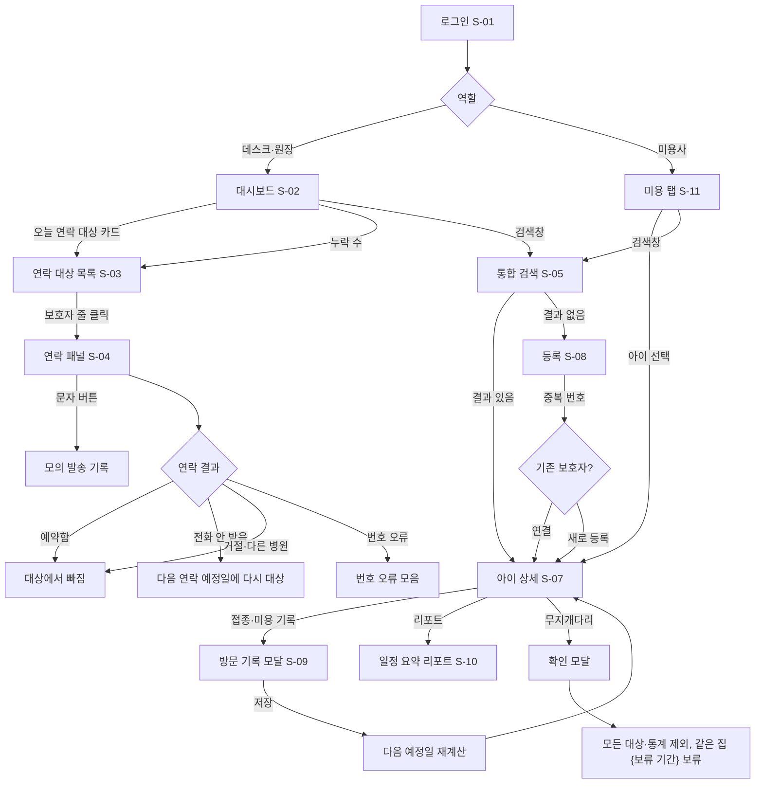

# 업무 분석 - 사용자

| 항목 | 내용 |
| --- | --- |
| 작성 | 신아림 |
| 작성일 | 2026-11-23 |
| 근거 자료 | [프로젝트 소개](./프로젝트%20소개(2026-11-23).md), [이벤트 스토밍](./이벤트%20스토밍(2026-11-23).md), [문제 결정판](https://claude.ai/artifact/NWxqPVhdcHypMfcLiNwSFj), [결정판 후속 안건](https://claude.ai/artifact/C5kWnw3rEiZ4Sdo5DL4viV) |
| 함께 볼 문서 | [업무 분석 - 백오피스](./업무%20분석_백오피스(2026-11-23).md) |
| 수정 | 2026-11-24 [팀 결정 기록](./팀%20결정%20기록(2026-11-24).md) 반영: S-11 미용 탭 추가, 미용사 첫 화면·흐름, 무지개다리 문구 {보류 기간} 2026-11-25 0장 화면 목록에 '관련 요구사항' 칸 추가, S-01~S-11마다 요구사항 명세서의 FR ID 연결 (#61) 2026-11-25 #61 리뷰 반영: S-07에 FR-CUS-006 등 빠진 연결 추가, 나가기 경고 화면에 S-06 추가, FR-ADM-009 표시 정리 2026-11-25 PR #67 CodeRabbit 리뷰 반영: S-07에서 FR-CUS-008을 뺌 (요구사항 명세서가 정보 수정을 S-06에 둠) 2026-11-25 2-0 로그인 흐름의 역할별 첫 화면을 팀 결정 T2 · FR-AUTH-001에 맞춤 (데스크·원장 S-02, 미용사 S-11) (#76). 2-6 미용사 흐름도 S-11을 첫 화면으로 적고 검색은 그다음 동작으로 2026-11-25 화면 설계(#93)에 맞춤: 원장 대시보드도 지표는 '오늘 할 일' 아래(화면 설계 8-1 5번), 같은 집 보류 '30일' 고정을 {보류 기간}(기본 30일)으로 (#108) 2026-11-25 S-07에 FR-CUS-008(아이 프로필 수정) 다시 연결: 요구사항 명세서가 아이 프로필 수정을 S-07 프로필 카드 [수정]으로 바꿈 (PR #113, 화면 설계 8-1 6번). 보호자 정보 수정 · 무지개다리 되돌리기는 그대로 S-06. 입력 폼이 생겨 나가기 경고 화면에 S-07 추가 (#114) 2026-11-27 2-1 5단계: 연락 결과 입력 칸은 결과와 상관없이 늘 보이는 것으로 화면 설계 SCR-S04-02에 맞춤, 결과별 표의 '추가로 받는 것'을 '적으면 좋은 것'으로 (#209, PR #205 리뷰) |
| 상태 | 초안 (팀 확정 전) |

병원 직원(데스크·미용사·원장)이 로그인해서 일을 끝내고 나갈 때까지의 흐름이다. 보호자는 화면을 쓰지 않는다(보호자 화면은 v2). 규칙 표·직원 계정 관리처럼 원장이 설정하는 일은 [업무 분석 - 백오피스](./업무%20분석_백오피스(2026-11-23).md)에서 다룬다.

---

## 0. 화면 목록 (이 문서에서 쓰는 이름)

| ID | 화면 | 주로 쓰는 사람 | 열리는 방식 | 관련 요구사항 |
| --- | --- | --- | --- | --- |
| S-01 | 로그인 | 전원 | 페이지 | FR-AUTH-001, FR-AUTH-003 |
| S-02 | 대시보드 (오늘·이번 주 대상, 누락, 지표) | 데스크, 원장 | 페이지 (로그인 후 첫 화면) | FR-AUTH-001, FR-DASH-001, FR-DASH-002, FR-DASH-003, FR-DASH-004, FR-DASH-005, FR-DASH-006 (v2로 미룸, 팀 결정 K5) |
| S-03 | 연락 대상 목록 (오늘 / 이번 주 / 누락 탭) | 데스크 | 페이지 | FR-TGT-001, FR-TGT-002, FR-TGT-003, FR-TGT-004, FR-CUS-005, FR-CYC-004 |
| S-04 | 연락 패널 (보호자·같은 집 아이·예정 항목, 결과 기록) | 데스크 | 오른쪽 사이드 패널 | FR-CNT-001, FR-CNT-002, FR-CNT-003, FR-CNT-005, FR-CNT-006, FR-CNT-007, FR-COM-004 (연락 기록 수정) |
| S-05 | 통합 검색 결과 | 데스크, 미용사 | 상단 검색창 드롭다운 → 페이지 | FR-SRCH-001, FR-SRCH-002, FR-SRCH-003, FR-SRCH-004, FR-CUS-007 (무지개다리 아이 회색 표시) |
| S-06 | 보호자 상세 (연락처, 주의 태그, 아이 목록) | 데스크 | 페이지 | FR-CUS-008, FR-CUS-003, FR-CUS-004, FR-CUS-005, FR-CUS-006 |
| S-07 | 아이 상세 (프로필 + 접종·미용·연락 통합 타임라인) | 전원 | 페이지 | FR-VIS-003, FR-CUS-003, FR-CUS-004, FR-CUS-005, FR-CUS-006 (번호 확인 배너), FR-CUS-007, FR-CUS-008 (아이 프로필 수정, 프로필 카드 [수정]), FR-CYC-001, FR-CYC-002, FR-COM-004, FR-RPT-001 |
| S-08 | 보호자·아이 등록 | 데스크 | 페이지 | FR-CUS-001, FR-CUS-002, FR-CUS-003, FR-CUS-004, FR-CUS-005, FR-CYC-001, FR-SRCH-004 (검색어 미리 채움) |
| S-09 | 방문 기록 입력 (접종 / 미용) | 데스크, 미용사 | 모달 | FR-VIS-001, FR-VIS-002, FR-VIS-004, FR-CYC-003, FR-CNT-004, FR-COM-004 (방문 기록 수정) |
| S-10 | 아이 일정 요약 리포트 | 데스크 | 새 탭 (출력용) | FR-RPT-001, FR-RPT-002, FR-ADM-009 (양식은 백오피스 B-05에서 정함) |
| S-11 | 미용 (오늘·이번 주 미용 예정 아이, 미용 기록) | 미용사, 데스크 | 페이지 (미용사 로그인 후 첫 화면) | FR-AUTH-001, FR-AUTH-002, FR-CYC-002, FR-VIS-002 |

- **모든 화면 공통:** FR-AUTH-002 (역할별 접근 제한), FR-AUTH-003 (로그인 만료 후 복귀), FR-COM-001 (저장 실패 처리), FR-COM-002 (화면별 한 줄 안내). 입력 폼이 있는 화면(S-04, S-06, S-07, S-08, S-09)은 FR-COM-003 (나가기 경고)도 따른다.
- 화면 안에서 결과만 보이는 서버 기능도 그 결과가 보이는 화면에 적었다. 예: FR-CYC-003 예정일 다시 계산, FR-CNT-004 전환 판정은 방문을 저장하는 S-09.
- 요구사항 명세서에 있는 ID만 썼다. 백오피스 화면(B-01~B-06), 곧 FR-ADM-001~009의 설정 화면은 [업무 분석 - 백오피스](./업무%20분석_백오피스(2026-11-23).md)에서 다룬다.

## 1. 사용자별 하루

| 사용자 | 언제 쓰나 | 주로 하는 일 | 첫 화면 |
| --- | --- | --- | --- |
| 데스크 실장·직원 | 출근 직후, 진료 사이 한가한 시간, 보호자 방문 접수 때 | 연락 대상 확인 → 보호자 연락 → 결과 기록, 방문 시 번호 확인·접종 기록, 신규 등록, 리포트 출력 | 대시보드 (오늘 연락 대상이 맨 위) |
| 미용사 | 미용 시작 전, 미용 끝난 직후 | 미용 예정 아이 확인 → 지난 미용 이력·접종 상태 확인 → 미용 기록 입력 | 미용 탭 S-11 (오늘·이번 주 미용 예정 아이) [팀 결정 T2] |
| 원장 | 하루·한 주 마감 때 | 재방문율·누락률·연락 효과 확인, 누락 아이 살펴보기 | 대시보드 (지표는 '오늘 할 일' 아래) |

## 2. 메인 프로세스

### 2-0. 공통: 로그인

> 로그인(S-01) → 아이디·비밀번호 입력 → 역할 확인 → 역할별 첫 화면(데스크·원장 S-02, 미용사 S-11)

- 직원별 계정으로 로그인한다. 기록한 직원 이름이 연락·방문 기록에 자동으로 남는 근거다 (B2, E2).
- 화면마다 위쪽에 한 줄 안내문을 둔다 (E3).

### 2-1. 데스크: 아침 연락 업무 (핵심 시나리오)

> 대시보드(S-02) → 오늘 연락 대상 목록(S-03) → 보호자 한 줄 클릭 → 연락 패널(S-04) → 전화 또는 문자(모의) → 결과 기록 → 목록에서 '처리됨' → 다음 보호자

| 단계 | 사용자 행동 | 시스템 반응 | 화면 |
| --- | --- | --- | --- |
| 1 | 대시보드에서 '오늘 연락할 아이 N명' 카드를 누른다 | 오늘 탭이 열린 연락 대상 목록으로 이동 | S-02 → S-03 |
| 2 | 목록을 훑는다 | 보호자 단위로 묶어 한 줄에 보여준다. 같은 집 아이들의 예정 항목(접종·미용)을 함께 표시. 선호 연락 방법·주의 태그·다음 연락 예정일 표시 | S-03 |
| 3 | 보호자 한 줄을 누른다 | 오른쪽에 연락 패널이 열린다. 목록은 그대로 남는다 | S-04 |
| 4 | 패널에서 아이별 예정 항목·지난 연락 기록을 확인하고 전화한다 (또는 '문자 보내기'를 누른다) | 문자는 실제로 보내지 않고 '모의 발송됨'으로 연락 기록에 남긴다 | S-04 |
| 5 | 결과 유형 버튼 5개 중 하나를 고른다: 예약함 / 전화 안 받음 / 거절 / 다른 병원 다님 / 번호 오류 | 입력 칸(메모 · 통화한 사람 · 다음 연락 예정일)은 결과와 상관없이 늘 보인다. 전화 안 받음을 고르면 다음 연락 예정일에 1일 뒤가 미리 채워진다 (화면 설계 SCR-S04-02) | S-04 |
| 6 | 짧은 메모, 통화한 사람(본인·가족), 다음 연락 예정일을 적고 저장한다 | 기록한 직원·시간을 자동으로 붙여 저장. 같은 집 아이 모두에 같은 결과를 적용할지 묻는 체크박스 제공 | S-04 |
| 7 | 저장 후 | 토스트 "연락 결과를 저장했습니다". 목록에서 그 보호자 줄이 '처리됨'으로 바뀌고 아래로 내려간다. 패널은 다음 보호자로 넘어갈지 묻는다 | S-03 |

결과 유형별로 달라지는 것

입력 칸은 늘 보인다. 아래 '적으면 좋은 것'은 결과별로 적으면 좋은 내용이다 (FR-CNT-002, NFR-USE-001, #153).

| 결과 유형 | 적으면 좋은 것 | 저장 뒤 |
| --- | --- | --- |
| 예약함 | 메모 (예약 날짜를 적어도 됨) | 대상 목록에서 빠진다. 실제 방문이 기록되면 전환으로 센다 |
| 전화 안 받음 | 다음 연락 예정일 (기본값: 1일 뒤) | 다음 연락 예정일에 다시 대상 목록에 올라온다 |
| 거절 | 메모 (사유) | 대상 목록에서 빠진다. 다시 올릴 시점은 정책 정의서에서 정한다 |
| 다른 병원 다님 | 메모 | 대상 목록에서 빠진다. 다시 올릴 시점은 정책 정의서에서 정한다 |
| 번호 오류 | - | 대시보드의 '번호 오류 보호자' 모음에 들어간다. 다음 방문 때 번호 확인 안내가 뜬다 |

### 2-2. 데스크: 보호자 방문 접수

> 상단 검색창 → 검색 결과(S-05) → 아이 상세(S-07) → 번호 확인 → 방문 기록 입력(S-09) → 저장 → 다음 예정일 갱신

| 단계 | 사용자 행동 | 시스템 반응 | 화면 |
| --- | --- | --- | --- |
| 1 | 상단 검색창에 번호 뒤 4자리, 보호자·아이 이름, 초성(ㅊㅋ) 중 하나를 입력한다 | 입력하는 동안 드롭다운에 결과 미리보기. 띄어쓰기·하이픈은 무시. 각 결과에 보호자 이름·번호 뒤 4자리·품종·나이 표시 (A2, E4) | S-05 |
| 2 | 아이를 고른다 | 아이 상세로 이동. 같은 집 다른 아이로 바로 가는 탭 표시 (A1) | S-07 |
| 3 | 번호를 마지막으로 확인한 날이 오래됐으면 안내가 뜬다 | "번호를 확인해 주세요 (마지막 확인: 2026-05-02)" 배너와 [확인함] [번호 수정] 버튼 (A3) | S-07 |
| 4 | 데려온 사람이 주 보호자가 아니면 그 사람 번호를 적는다 | 오늘 방문 기록에만 남고 보호자 정보는 바뀌지 않는다 (A4) | S-09 |
| 5 | [접종 기록] 버튼을 눌러 종류·날짜를 입력하고 저장한다 | 모달이 닫히고 타임라인 맨 위에 새 기록. 다음 접종 예정일이 다시 계산되어 표시 | S-09 → S-07 |

### 2-3. 데스크: 신규 보호자·아이 등록

> 검색 결과 없음(S-05) → [새로 등록] → 등록(S-08): 보호자 정보 → 아이 정보 → 저장 → 아이 상세(S-07)

| 단계 | 사용자 행동 | 시스템 반응 | 화면 |
| --- | --- | --- | --- |
| 1 | 검색 결과가 없을 때 [새로 등록]을 누른다 | 검색어가 번호면 전화번호 칸에, 이름이면 이름 칸에 미리 채운 등록 화면으로 이동 | S-05 → S-08 |
| 2 | 보호자 전화번호를 입력한다 | 같은 번호가 있으면 바로 경고: "이미 등록된 보호자입니다: 김OO (아이 2마리)" + [기존 보호자에 아이 추가] 버튼 (A5) | S-08 |
| 3 | 필수 항목을 입력한다: 아이 이름, 생년월일, 품종, 털 유형(품종·털 유형은 선택지), 보호자 전화번호 | 필수 칸이 다 차야 [저장] 버튼이 켜진다 (B1) | S-08 |
| 4 | 선택 항목은 비워 둔다 (보조 연락처, 선호 연락 방법, 등록번호, 사진, 펫보험 가입 여부, 체중) | 나중에 아이 상세에서 채울 수 있다. 사진은 보호자가 거절하면 넣지 않는다 | S-08 |
| 5 | [저장]을 누른다 | 나이 구간별 접종 예정일을 만들고 아이 상세로 이동 | S-07 |

### 2-4. 데스크: 아이 일정 요약 리포트

> 아이 상세(S-07) → [일정 요약 리포트] → 리포트(S-10) 새 탭 → 보호자에게 화면을 보여주거나 [출력]

- 담는 것: 접종·미용 지난 이력, 다음 예정일, 연락 기록 요약. 진료 내용은 담지 않는다 (후속 R1·R2).
- 출력은 브라우저 인쇄 기능을 쓴다 (A4 한 장).

### 2-5. 데스크: 무지개다리 처리

> 아이 상세(S-07) → 상태 [무지개다리로 변경] → 확인 모달 → 저장

- 확인 모달: "OO를 무지개다리로 표시하면 모든 연락 대상과 통계에서 빠집니다. 같은 집 다른 아이는 {보류 기간}일 동안 연락을 보류합니다." [취소] [변경] ({보류 기간}은 백오피스 기준값, 기본 30일)
- 저장 뒤 아이 상세 위쪽에 회색 '무지개다리' 표시. 기록은 지우지 않는다 (H1).

### 2-6. 미용사: 미용 전 확인과 미용 기록

> 로그인 → 미용 탭(S-11, 첫 화면) → 목록에서 아이 고르기 또는 상단 검색창(S-05) → 아이 상세(S-07): 지난 미용 이력·접종 상태 확인 → 미용 끝나면 [미용 기록](S-09) → 저장 → 다음 미용 예정일 확인

| 단계 | 사용자 행동 | 시스템 반응 | 화면 |
| --- | --- | --- | --- |
| 1 | 미용 탭에서 오늘 미용할 아이를 고르거나, 아이 이름·보호자 번호로 검색한다 | 미용 탭은 오늘·이번 주 미용 예정 아이를 보여준다. 검색은 데스크와 같다. 연락·등록·접종 기록·대시보드·백오피스는 열리지 않는다 (403) | S-11, S-05 |
| 2 | 아이 상세에서 지난 미용 기록과 접종 상태를 본다 | 타임라인을 '미용' 필터로 볼 수 있다. 접종이 누락이면 빨간 표시 | S-07 |
| 3 | 미용이 끝나면 [미용 기록]을 눌러 날짜·메모를 입력한다 | 날짜는 오늘로 미리 채워져 있다 | S-09 |
| 4 | 저장한다 | 그 아이의 실제 미용 간격으로 다음 미용 예정일을 다시 계산해 보여준다 | S-07 |

### 2-7. 원장: 재방문 결과 확인

> 로그인 → 대시보드(S-02) → 지표 확인 → 누락 아이 수 클릭 → 누락 탭(S-03) → 아이 상세(S-07)

| 대시보드 영역 | 보여주는 것 |
| --- | --- |
| 오늘·이번 주 | 연락 대상 아이 수, 처리한 수 |
| 누락 | 예정일 +14일이 지난 아이 수, 접종 누락률 |
| 재방문율 | 서비스별(접종·미용) 재방문율, 예정일 대비 실제 방문 차이(일) |
| 연락 효과 | 연락 결과 유형별 전환율, 연락 방법(전화·문자)별 전환율 |
| 번호 오류 | 번호 오류 보호자 모음 |

- 무지개다리 아이는 모든 숫자에서 빠진다.
- 기간(이번 달 / 지난 3개월 / 직접 선택)을 바꾸면 숫자가 다시 계산된다. 페이지 이동 없이 같은 화면에서 바뀐다.
- 첫 화면은 2초 안에 보여준다 (E1).

## 3. 예외 프로세스

| 상황 | 언제 생기나 | 처리 | 사용자에게 보이는 것 |
| --- | --- | --- | --- |
| 로그인 실패 | 아이디·비밀번호가 틀림 | 로그인 화면에 머문다. 5회 연속 실패 시 잠금 여부는 정책 정의서에서 정한다 | "아이디 또는 비밀번호가 맞지 않습니다." |
| 로그인 만료 | 오래 자리를 비움 | 로그인 화면으로 보내고, 다시 로그인하면 보던 화면으로 돌아온다 | "다시 로그인해 주세요." |
| 검색 결과 없음 | 등록되지 않은 보호자, 오타 | 결과 대신 [새로 등록] 버튼을 보여준다 | "'1234'로 찾은 보호자가 없습니다. 새로 등록할까요?" |
| 검색 결과가 너무 많음 | '초코'처럼 흔한 이름 | 보호자 이름·번호 뒤 4자리·품종·나이를 함께 보여주고, 20개씩 나눠 보여준다 | 결과 목록 + "번호 뒤 4자리를 함께 넣으면 더 빨리 찾을 수 있습니다." |
| 중복 전화번호 | 이미 있는 보호자를 새로 등록하려 함 | 저장 전에 경고하고 기존 보호자로 연결을 유도한다. 그래도 새로 만들 수는 있다 | 경고 박스 + [기존 보호자에 아이 추가] [그래도 새로 등록] |
| 필수 항목 빠짐 | 등록·기록 저장 시 | 저장 버튼을 끄고 빠진 칸을 빨갛게 표시 | "품종을 골라 주세요." |
| 생년월일을 모름 | 유기견·입양견 | 미정. 후속 안건 D2에서 '대략 나이' 입력은 고르지 않았다. 정책 정의서에서 정한다 | - |
| '연락 원치 않음' 보호자 | 주의 태그가 붙음 | 연락 대상 목록에 아예 나오지 않는다. 아이 상세에서는 태그가 보인다 | 보호자 카드 맨 위 빨간 태그 |
| 무지개다리 아이를 검색함 | 기록을 찾으려 할 때 | 검색에는 나오지만 회색으로 표시하고, 연락·기록 버튼을 숨긴다 | 이름 옆 '무지개다리' 표시 |
| 같은 집에 보류 중인 아이 | 무지개다리 후 {보류 기간}(기본 30일) 안 | 연락 대상 목록에서 빠지고, 아이 상세에 보류 해제 날짜를 보여준다 | "2026-12-20까지 연락 보류" |
| 번호 오류 보호자가 방문함 | 번호 오류 표시가 있는 보호자 | 아이 상세를 열면 번호 확인 배너를 먼저 띄운다 | "번호 오류로 표시된 보호자입니다. 새 번호를 확인해 주세요." |
| 예약함 이후 오지 않음 | 예약 후 미방문 | MVP에서는 따로 표시하지 않고, 예정일 +14일이 지나면 누락으로 다시 올라온다. 노쇼 표시는 v2 | 누락 탭에 다시 나옴 |
| 저장 실패 | 네트워크 끊김, 서버 오류 | 입력한 내용을 지우지 않고 그대로 둔다. 다시 시도 버튼 | "저장하지 못했습니다. 다시 시도해 주세요." |
| 대시보드가 늦게 뜸 | 데이터가 많을 때 | 숫자 카드 자리에 회색 자리 표시(스켈레톤)를 먼저 보여준다 | 로딩 스켈레톤 |
| 문자 보내기 | MVP는 실제 발송 없음 | 연락 기록에 '문자 (모의 발송)'로 남긴다 | "문자를 보낸 것으로 기록했습니다 (모의 발송)." |

AI 기능은 MVP에 없으므로 AI 응답 실패 처리는 해당하지 않는다.

## 4. UI 상호작용 정리

| 동작 | 결과 | 방식 |
| --- | --- | --- |
| 로그인 성공 | 역할별 첫 화면으로 이동 | 페이지 이동 |
| 대시보드 숫자 카드 클릭 | 해당 탭이 열린 연락 대상 목록으로 이동 | 페이지 이동 |
| 연락 대상 목록에서 보호자 줄 클릭 | 연락 패널 열림, 목록 유지 | 오른쪽 사이드 패널 |
| 연락 결과 저장 | 목록의 그 줄이 '처리됨'으로 바뀜 | 토스트 + 목록 갱신 |
| 상단 검색창 입력 | 결과 미리보기 | 드롭다운 |
| 검색에서 Enter | 전체 검색 결과 | 페이지 이동 |
| 검색 결과에서 아이 클릭 | 아이 상세 | 페이지 이동 |
| 접종·미용 기록 버튼 | 입력 창 | 모달 |
| 기록 저장 | 모달 닫힘, 타임라인 맨 위에 추가, 다음 예정일 갱신 | 토스트 + 화면 갱신 |
| 같은 집 다른 아이 탭 | 그 아이 상세 | 페이지 이동 (같은 레이아웃) |
| 무지개다리로 변경 | 확인 창 | 확인 모달 |
| 일정 요약 리포트 | 출력용 화면 | 새 탭 |
| 중복 번호 입력 | 경고 | 입력 칸 아래 경고 박스 (페이지 이동 없음) |
| 저장하지 않고 나가기 | 경고 | 확인 모달 "입력한 내용이 사라집니다" |

## 5. 프로세스 흐름도

## 6. 정해야 할 것

- 생년월일을 모르는 아이의 입력 방법 (후속 D2에서 '대략 나이'는 고르지 않음)
- '전화 안 받음'의 기본 다음 연락 예정일 (초안: 1일 뒤)
- '거절'·'다른 병원 다님' 뒤 다시 대상에 올릴 시점
- 연락 결과를 같은 집 아이 모두에 한 번에 적용할지
- 로그인 실패 잠금 기준, 로그인 유지 시간
- ~~미용사 첫 화면을 검색으로 할지 대시보드로 할지~~ → 미용 탭(S-11)으로 결정 (2026-11-24 팀 결정 T2)
